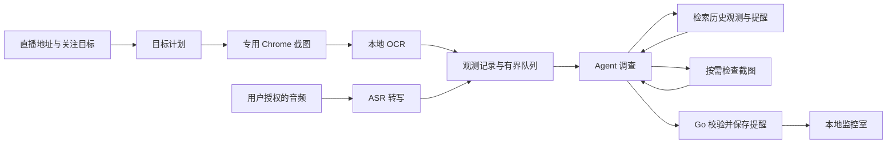

# LiveGuard

[](https://github.com/sdaAlbert/liveguard/actions/workflows/ci.yml)

LiveGuard 是一个本地运行的直播监控 Agent。输入直播地址和关注目标，它会持续采集可见画面中的文字，并在你授权后转写口播；Agent 结合当前信号与历史观测判断是否需要提醒。提醒会保存在本地监控室，并附带证据和调查记录。

## 能做什么

- 使用专用 Chrome 会话截图，通过本地 OCR 采集直播画面文字。
- 可选地处理用户主动分享的直播音频；当前 ASR 接入 MiniMax。
- 以本地网页查看监控、证据、调查过程和提醒；可选 PostgreSQL 持久化。
- 监控卡片可暂停/继续；持久化模式重启后，中断的运行会转为已暂停，用户可继续采集并保留原流水。

## 架构与行为

一次监控从用户提供的直播地址和关注目标开始。系统将目标整理为采集计划，然后持续接收截图 OCR、用户授权的口播转写，以及按计划产生的画面检查信号。



Agent 每次处理一条待调查信号，可以搜索已记录的文字观测、查看近期提醒，并在需要时检查截图。提醒由服务端校验证据引用、重复项、目标版本和监控状态后写入；模型不能直接改监控状态或发送外部消息。调查有轮数、工具调用数和执行时间限制，细节见[架构文档](docs/ARCHITECTURE.md)。

监控会话可以持续运行，但采集只覆盖实际观察到的画面和音频；采样间隔、页面可见区域和 OCR 质量都会影响信号覆盖。发生登录验证、输入异常或模型额度耗尽时，系统会显示相应状态。完整运行边界见[运行文档](docs/OPERATIONS.md)。

## 从哪里开始读

如果你第一次看 LiveGuard，建议先读[项目导览](docs/PROJECT-GUIDE.md)。它会从文件夹职责讲起，再按“网页创建任务 → 采集信号 → 排队调查 → 校验并保存提醒”的顺序解释核心代码、状态、异步处理和错误边界。

```text
cmd/liveguard       程序入口与依赖装配
internal/web        HTTP 接口、SSE 和本地网页
internal/monitor    监控生命周期、信号队列、证据、调查和存储
internal/agent      有界工具循环、请求重试和熔断
internal/browser    专用 Chrome 会话与截图
cmd/monitor-eval    固定文字集模型评测
cmd/monitor-load    合成信号负载测量
```

测试覆盖状态迁移、异步队列、幂等、超时/取消、工具限制和 HTTP 流程。仓库也有文字模型评测与合成负载程序；现有负载程序走同步 `Ingest` 和 mock 模型，尚不能证明真实采集或异步队列的端到端吞吐。评测结果的适用范围和建议补测项见[评测文档](docs/EVALUATION.md)。

## 模型

选择模型提供方、模型名称和 API Key。图片理解由所选模型能力决定；自定义模型需支持工具调用，并在支持图片输入时启用图片理解。

| 提供方 | 默认模型 | 图片输入 |
|---|---|---|
| MiniMax | `MiniMax-M3` | 支持 |
| OpenAI | `gpt-4.1-mini` | 支持 |
| DeepSeek | `deepseek-flash` | 支持 |

口播转写是独立配置，目前接入 MiniMax ASR。

LiveGuard 只能分析实际采集到的信号，不能保证覆盖所有评论或短暂画面变化。提醒目前只保存在应用中，不会发送到微信、短信或其他外部渠道。当前提供 Windows 快速启动流程；项目限制和安全说明见[运行文档](docs/OPERATIONS.md)。

## 快速开始

需要 Windows 10/11、Go 1.25、Google Chrome 和 Tesseract OCR。中文识别建议安装 `chi_sim` 数据包。

```powershell
git clone https://github.com/sdaAlbert/liveguard.git
cd liveguard
powershell -ExecutionPolicy Bypass -File ./scripts/run-mvp.ps1
```

打开 <http://127.0.0.1:8080>，在专用 Chrome 窗口登录直播平台，然后新建监控。需要使用大模型时，在网页右上角的“模型设置”中选择提供方并配置 API Key；模型设置不会发送探测请求。没有配置大模型时可使用本地规则模式。

## 文档

- [文档导航](docs/README.md)：按初次阅读顺序或具体问题查找资料。
- [项目导览：从目录到一次提醒](docs/PROJECT-GUIDE.md)：面向初次阅读者，解释术语、目录、完整调用路线、状态和可靠性设计。
- [架构与 Agent 行为](docs/ARCHITECTURE.md)：数据流、模型适配、工具、证据、调度、上下文与持久化设计。
- [运行、配置与故障处理](docs/OPERATIONS.md)：运行时长、API 配置、PostgreSQL、接口、限制和恢复方式。
- [评测与验证](docs/EVALUATION.md)：现有测试地图、历史评测、负载测量和结果适用范围。
- [仍存在的风险](docs/PROJECT-REVIEW.md)：采集覆盖、长期存储、事件统计和改进优先级。
- [贡献指南](CONTRIBUTING.md)

## 安全与隐私

服务默认只监听本机，不适合作为公网服务直接部署。API Key 保存在 Go 服务进程内存或用户配置的环境变量中；不要提交密钥、登录资料或私人截图。详细说明见[运行文档](docs/OPERATIONS.md#安全边界)。

## License

[MIT](LICENSE)
