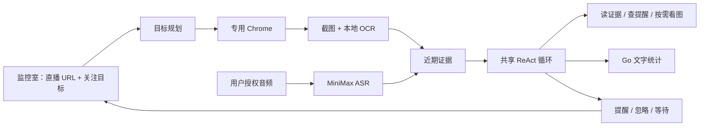

# LiveGuard

[中文](README.md) · [English](README_EN.md)

[](https://github.com/sdaAlbert/liveguard/actions/workflows/ci.yml)

LiveGuard 是一个用 Go 编写的个人直播监控 Agent。输入直播 URL 和关注目标，Agent 监看可见聊天文字与主播活动；目标命中时发送带证据的提醒。用户授权后也可识别口播。

创建监控时，模型将目标整理成采集与复核计划。每条新信号进入同一个 ReAct 循环；Agent 可读取近期证据、查询历史提醒、按需查看画面，再选择提醒、忽略或继续等待。服务端限制工具权限、执行时长、重试和重复提醒。模型不可用时可使用能力有限的本地规则模式。

## 本地运行

需要 Windows、Go、Google Chrome 和 Tesseract。默认监控使用内存状态，不需要 Docker、数据库或 Redis；进程退出后本地监控历史会清空。

```powershell
powershell -ExecutionPolicy Bypass -File .\scripts\run-mvp.ps1
```

打开 <http://127.0.0.1:8080>，登录专用 Chrome 窗口后添加直播间。口播识别需要在监控卡片中主动授权分享音频。模型图片理解和 ASR 会产生 API 用量。

若已在本机 OpenClaw 配置 MiniMax，启动脚本可复用该配置；密钥不会写入仓库或打印。模型评测会产生 API 用量；先跑开发集，确认样本后再运行冻结集：

```powershell
powershell -ExecutionPolicy Bypass -File .\scripts\verify-minimax-live.ps1 -Evaluate -Split dev
powershell -ExecutionPolicy Bypass -File .\scripts\verify-minimax-live.ps1 -Evaluate -Split holdout-v1
```

评测设计和限制见 [Agent Harness 评测说明](docs/AGENT-EVAL-HARNESS.md)。

真实抖音连续监控尚未完成端到端验收。合成信号和固定文字模型评测不能证明真实直播采集、音频分享或提醒延迟已经达标。当前状态与验收步骤见[直播 Agent 设计与验收计划](docs/DESIGN-LIVE-SIGNAL-AGENT.md)。

## 架构



## 项目结构

- `internal/agent`：通用 ReAct 循环与模型调用基础。
- `internal/monitor`：监控状态、信号采集入口、证据校验、工具与提醒。
- `internal/browser`：专用 Chrome 会话和直播页面截图。
- `internal/web`：监控室和 HTTP API。
- `docs/DESIGN-LIVE-SIGNAL-AGENT.md`：当前设计、边界、验收进度与下一步。

## 当前边界

- 每个监控窗口独立运行，最多 8 个活跃窗口。
- Agent 不会自动点击、领券、发评论或执行模型生成的代码。
- 浏览器截图 OCR、音频分享、ASR 和提醒延迟仍需用真实直播间完成连续验收。

## License

[Apache-2.0](LICENSE)
