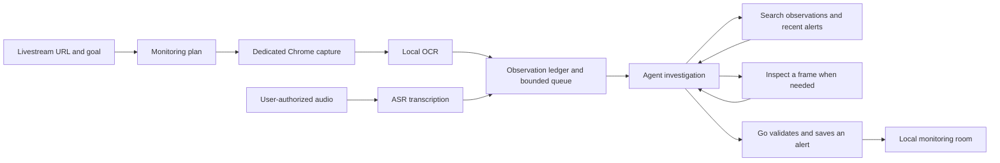

# LiveGuard

[English](README.md) | [简体中文](README.zh-CN.md)

[](https://github.com/sdaAlbert/liveguard/actions/workflows/ci.yml)

LiveGuard is a locally run livestream monitoring agent. Add a livestream URL and describe what you want to watch for. LiveGuard collects visible on-screen text, can transcribe audio that you explicitly share, and uses an agent to review incoming signals together with recorded observations. Alerts stay in the local monitoring room with their evidence and investigation history.

The project works with livestream pages from Douyin, Bilibili, Kuaishou, and similar platforms through the same browser capture, OCR, and agent workflow. It does not call platform-private APIs. Bilibili is the main platform used for development and multi-room testing. Platform login, anti-abuse controls, and concurrent-viewing limits still apply; LiveGuard does not bypass them.

## What it does

- Captures a dedicated Chrome session and uses local OCR to read visible text from the livestream page.
- Optionally transcribes audio that you explicitly share from the browser; the current ASR integration uses MiniMax.
- Provides a local web UI for monitors, evidence, investigation steps, and alerts. Monitor state, the observation ledger, and recoverable pending signals are stored in a local SQLite database by default. A JSON export command is available for inspection and archiving.
- Lets you pause and resume monitors. In persistent mode, monitors that were running when the process stopped are restored as paused, with their saved history intact.

## Screenshots from a running instance

These screenshots show the local UI while LiveGuard is running. The monitoring room summarizes several livestream tasks; a monitor detail page shows recent judgments, evidence, and the agent's investigation state. You can also add a clarification while an investigation is in progress.


The monitoring room uses status indicators for running monitors, new alerts, and items that need confirmation or attention. Each card shows the livestream, monitoring goal, and latest agent status. The page also summarizes new alerts and pending work. In this snapshot, several monitors are active while some signals are waiting to be reviewed.


The detail page shows a product-launch monitor. The agent first reports that OCR has not found a clear launch announcement and that the visible price is uncertain. After the user adds a budget, the agent starts reviewing the evidence again. The page shows the monitoring goal, latest judgment, evidence source, and whether the current frame was inspected. The platform status at the top also says login or verification is required, illustrating that capture health and investigation progress are separate states.

Each screenshot captures one moment in an asynchronous workflow. It does not mean that every signal produces an alert, and it is not an accuracy or end-to-end latency benchmark. For queue behavior, evidence rules, and evaluation limits, see the [architecture](docs/ARCHITECTURE.en.md) and [evaluation](docs/EVALUATION.en.md) guides.

## Architecture and behavior

A monitor starts with a livestream URL and a monitoring goal. LiveGuard turns the goal into a capture plan, then receives OCR signals, audio transcripts that the user has authorized, and scheduled frame checks.



For each investigation, the agent can search recorded text observations, check recent alerts, and inspect a screenshot when needed. The Go service validates evidence references, duplicates, the current goal version, and monitor state before it saves an alert. The model cannot directly change monitor state or send messages outside the app. Investigations have limits on turns, tool calls, and execution time; see the [architecture guide](docs/ARCHITECTURE.en.md).

LiveGuard supports up to 8 active monitors and up to 4 concurrent agent investigations across the process. Investigations for the same monitor run one at a time. OCR capture and model review are scheduled independently: capture starts with a 1-second interval and adjusts to the machine's screenshot and OCR speed. While a model is busy, pending review triggers can be coalesced while recognized text remains searchable. Temporary capture failures use backoff and retry.

Monitoring can run continuously, but LiveGuard only analyzes signals it actually captures. Sampling interval, visible page area, and OCR quality affect coverage. The app reports login or verification requirements, persistent input failures, and model quota exhaustion. The limit of 8 active monitors is a scheduling capacity, not a promise that every computer can OCR 8 streams every second or call 8 models at once. See the [evaluation notes](docs/EVALUATION.en.md) and [operational limits](docs/OPERATIONS.en.md) for measurement conditions.

## Where to start reading

If you are new to the project, start with the [project guide](docs/PROJECT-GUIDE.en.md). It explains the folders and follows a request from “create a monitor” through “capture a signal,” “queue an investigation,” and “validate and save an alert.” Simplified Chinese versions are available from each guide.

```text
cmd/liveguard       Application entry point and dependency wiring
internal/web        HTTP handlers, SSE updates, and local web UI
internal/monitor    Monitor lifecycle, signal queues, evidence, reviews, and storage
internal/agent      Bounded tool loop, request retries, and circuit breaker
internal/browser    Dedicated Chrome session and screenshot capture
cmd/monitor-eval    Fixed text-set model evaluation
cmd/monitor-load    Synthetic signal load measurement
```

Automated tests cover state transitions, asynchronous queues, idempotency, timeouts and cancellation, tool limits, and HTTP flows. The repository also includes a text-evaluation entry point and synthetic load programs. The current text-evaluation result is not published as a model-quality score; mock load does not establish real capture or end-to-end livestream throughput. See the [evaluation guide](docs/EVALUATION.en.md) for details.

## Models

Choose a model provider, model name, and API key in the app. Image understanding depends on the configured model's declared capabilities. Custom models must support tool calling; enable image understanding only when the model accepts image input.

| Provider | Project default | Presets / status |
|---|---|---|
| MiniMax | `MiniMax-M3` | `MiniMax-M3` |
| OpenAI | `gpt-6-luna` | `gpt-6-luna`, `gpt-6-sol` |
| DeepSeek | `deepseek-flash` | Current alias for DeepSeek V4.1 Flash |

You can select a provider preset or enter another compatible model ID. Custom models must support tool calling, and their image capability should match the model you selected. For Chat Completions, LiveGuard sets `reasoning_effort: "none"` for GPT-6 Luna and GPT-6 Sol. Availability still depends on your account and the provider. See the [OpenAI deployment checklist](https://developers.openai.com/api/docs/guides/deployment-checklist) and [DeepSeek V4.1 Flash announcement](https://api-docs.deepseek.com/news/news260910/).

Audio transcription is configured separately and currently uses MiniMax ASR.

LiveGuard can only analyze signals it captures; it cannot guarantee coverage of every comment or brief visual change. Alerts are stored in the app and are not sent to WeChat, SMS, or other external channels. The current quick-start flow is for Windows. See the [operations guide](docs/OPERATIONS.en.md) for limitations and security details.

## Quick start

Requirements: Windows 10/11, Go 1.25, Google Chrome, and Tesseract OCR. For Chinese text recognition, install the `chi_sim` language data.

```powershell
git clone https://github.com/sdaAlbert/liveguard.git
cd liveguard
powershell -ExecutionPolicy Bypass -File ./scripts/run-mvp.ps1
```

Open <http://127.0.0.1:8080>. Sign in to the livestream platform in the dedicated Chrome window, then create a monitor. To use an LLM, open **Model settings** in the top-right corner and configure a provider and API key. Saving model settings does not send a probe request. Without an LLM, you can use the local rules mode.

## Documentation

- [Documentation index](docs/README.en.md): English reading paths and topic index.
- [Project guide](docs/PROJECT-GUIDE.en.md): folders, terminology, full request path, state, and reliability design.
- [Architecture and agent behavior](docs/ARCHITECTURE.en.md): data flow, model adapters, tools, evidence, scheduling, context, and persistence.
- [Agent Harness guide](docs/AGENT-HARNESS.en.md): the generic tool loop, livestream integration, asynchronous scheduling, final validation, limits, failure handling, and evaluation.
- [Operations and troubleshooting](docs/OPERATIONS.en.md): startup, configuration, local data files, APIs, limits, and recovery.
- [Evaluation and verification](docs/EVALUATION.en.md): automated tests, real runtime latency records, synthetic load measurements, and their limits.
- [Improvement roadmap](docs/ROADMAP.en.md): known gaps, candidate improvements, and evidence for completion.
- [简体中文文档导航](docs/README.md): Chinese reading paths and topic index.
- [Contributing](CONTRIBUTING.md)

## Security and privacy

The server listens on localhost by default and is not intended to be exposed directly to the public internet. API keys stay in the Go process memory or in environment variables that you configure. Do not commit secrets, login data, or private screenshots.

## License

[MIT](LICENSE)
