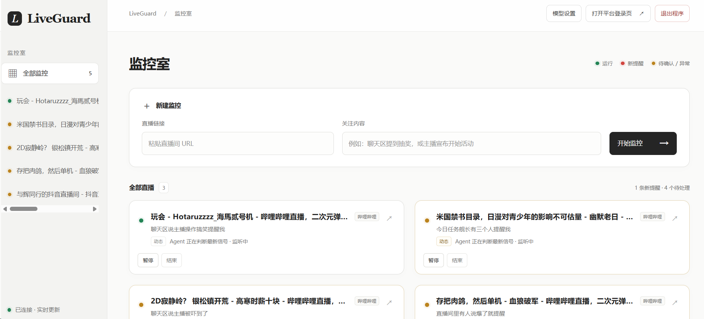
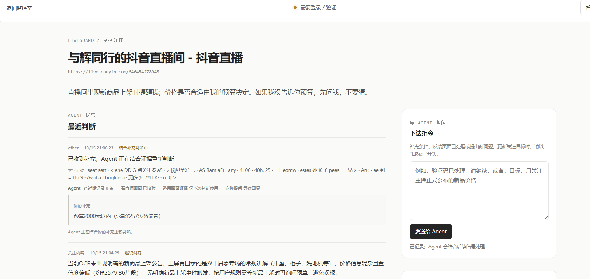

# LiveGuard

[English](README.md) | [简体中文](README.zh-CN.md)

[](https://github.com/sdaAlbert/liveguard/actions/workflows/ci.yml)

LiveGuard 是一个本地运行的直播监控 Agent，帮助用户不用一直盯着多个直播屏幕，也能持续关注指定内容并收到提醒。输入直播地址和关注目标后，它会采集可见文字，并在你授权后转写口播；Agent 结合当前信号和历史观测进行调查，提醒连同证据保存在本地监控室。

项目支持抖音、B 站、快手等网页直播平台，使用同一套浏览器采集、OCR 和 Agent 调查流程，不依赖单个平台的私有接口。当前主要应用和多路测试场景是 B 站。平台登录、风控和同时观看限制仍然适用，LiveGuard 不会绕过这些限制。

## 能做什么

- 使用专用 Chrome 会话截图，通过本地 OCR 读取直播页面中的可见文字。
- 可选处理用户主动分享的直播音频；当前 ASR 接入 MiniMax。
- Agent 可调查信号、检索历史观测，并在需要时检查截图。
- 后续调查会携带有界的调查记忆：已完成调查形成的短摘要与证据引用会随 Run 持久化，24 小时后过期，只作为历史线索；新提醒仍必须引用当前调查验证过的证据。
- 对明确指定的 OCR 目标词，可跟踪它在可读画面中的出现与消失；消失需连续 3 次成功采样未识别到该词才触发。画面中看不到文字不等于商品已下架或售罄。
- 默认使用本机 SQLite 保存监控状态、观测流水和可恢复的待处理信号；JSON 导出用于查看和归档。
- 监控室新增本机运行指标面板，展示队列积压与最老等待时间、模型失败和 Token 用量、模型费用估算及平均提醒延迟。模型调用摘要保存在 SQLite；费用估算需要配置模型价格表。
- 新增 Windows 运行采样脚本，定时保存 `/api/metrics` 快照、队列变化、Go 运行时内存/协程数和 LiveGuard 进程资源，方便事后查看真实运行情况。它只采集运行数据，不会生成模拟负载。
- 调查记录会保存有界的 Agent 轮次 trace；可在调查详情中回放已记录的模型轮次和工具结果。回放不会调用模型，也不会重复执行工具副作用。
- 监控室界面支持简体中文和英文，可通过右上角按钮切换，语言选择会保存在当前浏览器中。直播间名称、关注目标、证据和 Agent 生成的判断会保留原文。

## 运行效果

监控室汇总运行中的直播任务和待处理状态。



详情页展示 Agent 状态、关键证据和调查记录。



## 快速开始

需要 Windows 10/11、Go 1.25、Google Chrome 和 Tesseract OCR。中文识别建议安装 `chi_sim` 数据包。

```powershell
git clone https://github.com/sdaAlbert/liveguard.git
cd liveguard
powershell -ExecutionPolicy Bypass -File ./scripts/run-mvp.ps1
```

打开 <http://127.0.0.1:8080>，在专用 Chrome 窗口登录直播平台，然后新建监控。需要使用大模型时，在“模型设置”中选择提供方并配置 API Key；保存设置不会发送探测请求。

点击监控室右上角的 **EN / 中文** 按钮即可切换界面语言；选择会保存在当前浏览器中。

## 项目边界

LiveGuard 只能分析实际采集到的信号；采样间隔、页面可见内容和 OCR 质量都会影响覆盖范围。提醒保存在应用内，不会发送到微信、短信或其他外部渠道。最多 8 个活跃监控是调度上限，不代表任意电脑都能让 8 路直播每秒完成 OCR。当前快速启动流程面向 Windows。

## 调查回放

新发生的模型调查会保存 Agent 规范化后的模型轮次和工具结果。在调查详情中点击“回放调查流程”，即可用这些记录再走一遍 Agent 循环。回放不会调用模型服务或真实工具，因此不会再次提醒，也不会修改监控目标。它检查记录的流程和最终决策是否一致，不会根据原始提示词重新生成模型答案。每个监控最多保留 20 条 trace；工具结果有大小上限，截图字节不保留。trace 中的直播文本和工具参数可能包含本机敏感信息。

## 文档

- [文档导航](docs/README.md)：阅读顺序和主题索引。
- [项目导览：从目录到一次提醒](docs/PROJECT-GUIDE.md)：目录、术语、调用流程、状态和测试地图。
- [架构与 Agent 行为](docs/ARCHITECTURE.md)：证据、工具、调度、上下文和持久化设计。
- [运行、配置与故障处理](docs/OPERATIONS.md)：启动、本机数据、限制和恢复方式。
- [评测与验证](docs/EVALUATION.md)：自动化测试、真实运行记录、合成负载及证据边界。
- [Agent Harness 详解](docs/AGENT-HARNESS.md) · [优化路线图](docs/ROADMAP.md) · [贡献指南](CONTRIBUTING.md)
- [English documentation index](docs/README.en.md)

## 更新记录

- **2026-10 — 有界调查记忆：**已完成的调查可为同一监控目标的后续调查留下短小且关联证据的摘要。记忆随 Run 持久化，最多保存 32 条、每次调查最多注入 5 条，基于证据时间 24 小时后过期，修改目标后清除。它只提供历史线索；观测流水仍是事实来源，新提醒必须引用当前调查验证过的证据。
- **2026-10 — OCR 可见状态跟踪：**对目标计划明确提取的词跟踪画面文字的出现/消失；消失需连续 3 次成功 OCR 采样均未识别到。该状态仅表示文字在当前可读画面中的可见性，不代表实际库存或商品下架状态。
- **2026-10 — SQLite 持久化：**将运行时的 JSON 快照、JSONL 观测流水和内存 Pending 队列统一到 SQLite 事务存储，使监控状态、观测和已接收的待处理信号能一起提交，并在重启后恢复仍有效的排队工作。移除了重复的 JSON 运行仓储；JSON 导出继续用于查看和归档，但不包含 Pending 队列。
- **2026-10 — 运行指标：**新增只读本机指标接口和监控室面板，查看队列等待、模型调用结果与用量、费用估算和提醒延迟。指标汇总本身不是可重放 trace，也不是多实例外部监控面板；调查回放另见下方记录。
- **2026-10 — 运行采样：**新增 `scripts/capture-runtime.ps1`，将进程和 Go 运行时资源与队列、模型指标一起采样，保存为带时间戳的 CSV/JSONL 文件。使用方式和解读限制见评测文档。
- **2026-10 — 调查回放：**新增本机有界调查 trace 和详情页回放入口，记录规范化后的 Agent 模型轮次与工具结果。回放检查相同的循环路径，不重新调用模型，也不从原始提示词重跑推理。

## 安全与隐私

服务默认只监听本机，不适合作为公网服务直接暴露。API Key 保存在 Go 服务进程内存或用户配置的环境变量中；不要提交密钥、登录资料或私人截图。详细说明见[运行文档](docs/OPERATIONS.md)。

## License

[MIT](LICENSE)
