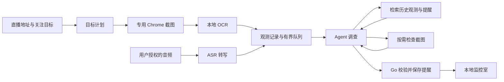

# LiveGuard

[English](README.md) | [简体中文](README.zh-CN.md)

[](https://github.com/sdaAlbert/liveguard/actions/workflows/ci.yml)

LiveGuard 是一个本地运行的直播监控 Agent，主要是为了让人不用一直盯着多个直播屏幕，也能持续关注指定内容并收到提醒。输入直播地址和关注目标后，它会采集可见画面中的文字，并在你授权后转写口播；Agent 结合当前信号与历史观测判断是否需要提醒。提醒保存在本地监控室，并附带证据和调查记录。

项目面向抖音、B 站、快手等网页直播平台，使用同一套浏览器采集、OCR 和 Agent 调查流程，不依赖单个平台的私有接口。当前主要应用和测试场景是 B 站。平台自身的登录、风控和同时观看限制仍然适用：例如抖音对同一账号连续进入多个直播间有限制，因此多路并发验证以 B 站场景为主；LiveGuard 不会绕过平台限制。

## 能做什么

- 使用专用 Chrome 会话截图，通过本地 OCR 采集直播画面文字。
- 可选地处理用户主动分享的直播音频；当前 ASR 接入 MiniMax。
- 以本地网页查看监控、证据、调查过程和提醒；监控状态和观测流水保存在本机 JSON 文件中。
- 监控卡片可暂停/继续；持久化模式重启后，中断的运行会转为已暂停，用户可继续采集并保留原流水。

## 运行效果

下面是 LiveGuard 本地网页的实际运行截图：监控室用于同时查看多个直播任务；详情页用于查看某个任务的最近判断、证据和 Agent 调查状态，并可以向正在运行的调查补充条件。


监控室顶部用状态图例区分运行中、新提醒和待确认/异常。每张卡片显示对应直播间、关注内容和最近的 Agent 状态；页面也会汇总新提醒与待处理任务数量。截图中可见多个监控并行运行，其中一些正在等待或处理新信号。


详情页展示某次商品上架监控：Agent 先结合 OCR 观测认为当前画面还没有明确上架公告，并指出价格信息存在不确定性；用户补充预算后，Agent 状态变为重新结合证据判断。页面同时保留关注目标、最近判断、证据来源和本次画面是否经过检查，方便理解提醒是如何得出的。截图顶部也显示平台需要登录/验证，说明详情页会展示采集侧状态，调查状态和平台连接状态需要分开看。

截图反映的是采集和调查过程中的一个时刻，不表示每条直播信号都会产生提醒，也不是模型准确率或端到端延迟的评测结果。异步调查可能继续变化；队列状态、证据和评测边界见[架构文档](docs/ARCHITECTURE.md)与[评测文档](docs/EVALUATION.md)。

## 架构与行为

一次监控从用户提供的直播地址和关注目标开始。系统将目标整理为采集计划，然后持续接收截图 OCR、用户授权的口播转写，以及按计划产生的画面检查信号。



Agent 每次处理一条待调查信号，可以搜索已记录的文字观测、查看近期提醒，并在需要时检查截图。提醒由服务端校验证据引用、重复项、目标版本和监控状态后写入；模型不能直接改监控状态或发送外部消息。调查有轮数、工具调用数和执行时间限制，细节见[架构文档](docs/ARCHITECTURE.md)。

最多同时运行 8 个监控，Agent 调查全进程最多并发 4 个，同一直播间串行调查。OCR 和模型复核分别调度：采样以 1 秒为起点，随本机截图和 OCR 实际耗时调整；慢模型期间合并待复核触发，已识别文字仍可搜索。临时采集故障自动退避恢复。

监控会话可以持续运行，但采集只覆盖实际观察到的画面和音频；采样间隔、页面可见区域和 OCR 质量都会影响信号覆盖。发生登录验证、持续输入故障或模型额度耗尽时，系统会显示相应状态。8 个活跃监控是调度容量，不代表任意电脑都能让 8 路直播每秒完成一次 OCR 或同时调用 8 个模型。[验证记录](docs/EVALUATION.md)与[运行边界](docs/OPERATIONS.md)给出测试条件。

## 从哪里开始读

如果你第一次看 LiveGuard，建议先读[项目导览](docs/PROJECT-GUIDE.md)。它会从文件夹职责讲起，再按“网页创建任务 → 采集信号 → 排队调查 → 校验并保存提醒”的顺序解释核心代码、状态、异步处理和错误边界。

```text
cmd/liveguard       程序入口与依赖装配
internal/web        HTTP 接口、SSE 和本地网页
internal/monitor    监控生命周期、信号队列、证据、调查和存储
internal/agent      有界工具循环、请求重试和熔断
internal/browser    专用 Chrome 会话与截图
cmd/monitor-eval    固定文字集模型评测
cmd/monitor-load    合成信号负载测量
```

测试覆盖状态迁移、异步队列、幂等、超时/取消、工具限制和 HTTP 流程。仓库也有文字模型评测与合成负载程序；现有负载程序走同步 `Ingest` 和 mock 模型，尚不能证明真实采集或异步队列的端到端吞吐。各类评测结果的适用范围见[评测文档](docs/EVALUATION.md)。

## 模型

选择模型提供方、模型名称和 API Key。图片理解由所选模型能力决定；自定义模型需支持工具调用，并在支持图片输入时启用图片理解。

| 提供方 | 项目当前默认模型 | 可选预设模型 / 状态 |
|---|---|---|
| MiniMax | `MiniMax-M3` | `MiniMax-M3` |
| OpenAI | `gpt-6-luna` | `gpt-6-luna`、`gpt-6-sol` |
| DeepSeek | `deepseek-flash` | `deepseek-flash`，当前有效别名，指向 DeepSeek V4.1 Flash |

模型设置中可选择提供方的常用预设，也可手动输入其他兼容模型 ID；自定义模型需支持工具调用，图片理解能力需按实际情况设置。OpenAI 的 GPT-6 Luna 和 GPT-6 Sol 使用 Chat Completions 时由 LiveGuard 设置 `reasoning_effort: "none"`。模型可用性仍取决于账号权限和提供方状态。详情见[OpenAI 部署检查清单](https://developers.openai.com/api/docs/guides/deployment-checklist)和[DeepSeek V4.1 Flash 发布说明](https://api-docs.deepseek.com/news/news260910/)。

口播转写是独立配置，目前接入 MiniMax ASR。

LiveGuard 只能分析实际采集到的信号，不能保证覆盖所有评论或短暂画面变化。提醒目前只保存在应用中，不会发送到微信、短信或其他外部渠道。当前提供 Windows 快速启动流程；项目限制和安全说明见[运行文档](docs/OPERATIONS.md)。

## 快速开始

需要 Windows 10/11、Go 1.25、Google Chrome 和 Tesseract OCR。中文识别建议安装 `chi_sim` 数据包。

```powershell
git clone https://github.com/sdaAlbert/liveguard.git
cd liveguard
powershell -ExecutionPolicy Bypass -File ./scripts/run-mvp.ps1
```

打开 <http://127.0.0.1:8080>，在专用 Chrome 窗口登录直播平台，然后新建监控。需要使用大模型时，在网页右上角的“模型设置”中选择提供方并配置 API Key；模型设置不会发送探测请求。没有配置大模型时可使用本地规则模式。

## 文档

- [文档导航](docs/README.md)：按初次阅读顺序或具体问题查找资料。
- [项目导览：从目录到一次提醒](docs/PROJECT-GUIDE.md)：面向初次阅读者，解释术语、目录、完整调用路线、状态和可靠性设计。
- [架构与 Agent 行为](docs/ARCHITECTURE.md)：数据流、模型适配、工具、证据、调度、上下文与持久化设计。
- [Agent Harness 详解](docs/AGENT-HARNESS.md)：从通用工具循环到直播领域接入、异步调度、最终提交、预算、失败处理、评测和面试讲解。
- [运行、配置与故障处理](docs/OPERATIONS.md)：运行时长、本机数据文件、API 配置、接口、限制和恢复方式。
- [评测与验证](docs/EVALUATION.md)：现有测试地图、历史评测、负载测量和结果适用范围。
- [优化路线图](docs/ROADMAP.md)：已知问题、候选改进方向和验收证据。
- [贡献指南](CONTRIBUTING.md)

## 安全与隐私

服务默认只监听本机，不适合作为公网服务直接部署。API Key 保存在 Go 服务进程内存或用户配置的环境变量中；不要提交密钥、登录资料或私人截图。详细说明见[运行文档](docs/OPERATIONS.md#安全边界)。

## License

[MIT](LICENSE)
