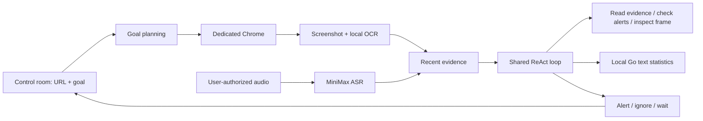

# LiveGuard

[中文](README.md) · [English](README_EN.md)

[](https://github.com/sdaAlbert/liveguard/actions/workflows/ci.yml)

LiveGuard is a personal livestream monitoring agent written in Go. Enter a livestream URL and a goal. The agent monitors visible chat and host activity, then sends evidence-backed alerts when the goal matches. With explicit user consent, it can also recognize speech.

When a monitor starts, the model turns the goal into a bounded capture and review plan. Each new signal enters the same ReAct loop. The agent can read recent evidence, check past alerts, inspect a frame when useful, then alert, ignore, or wait. The server limits tool access, execution time, retries, and duplicate alerts. A limited local rules mode remains available without a model.

## Run locally

Requires Windows, Go, Google Chrome, and Tesseract. The default monitor keeps state in memory and does not require Docker, a database, or Redis; local monitor history is cleared when the process exits.

```powershell
powershell -ExecutionPolicy Bypass -File .\scripts\run-mvp.ps1
```

Open <http://127.0.0.1:8080> and sign in through the dedicated Chrome window. Speech recognition requires explicitly sharing audio from a monitor card. Image understanding and ASR use API quota.

If MiniMax is configured in the local OpenClaw settings, the launcher can reuse that provider configuration without printing or saving the key. Model evaluation consumes API usage. Run the development split first, review its labels, then run the frozen holdout:

```powershell
powershell -ExecutionPolicy Bypass -File .\scripts\verify-minimax-live.ps1 -Evaluate -Split dev
powershell -ExecutionPolicy Bypass -File .\scripts\verify-minimax-live.ps1 -Evaluate -Split holdout-v1
```

See the [Agent harness evaluation guide](docs/AGENT-EVAL-HARNESS.md) for scope and limitations.

Continuous monitoring of a real Douyin livestream has not completed end-to-end acceptance. Synthetic signals and fixed-text model evaluation do not prove that real capture, audio sharing, or alert latency works as intended. See the [design and acceptance plan](docs/DESIGN-LIVE-SIGNAL-AGENT.md) for current status and next steps.

## Architecture



## Repository map

- `internal/agent`: reusable ReAct loop and model-call foundations.
- `internal/monitor`: monitor state, signal ingestion, evidence checks, tools, and alerts.
- `internal/browser`: dedicated Chrome session and livestream screenshots.
- `internal/web`: control room and HTTP API.
- `docs/DESIGN-LIVE-SIGNAL-AGENT.md`: current design, boundaries, acceptance status, and next steps.

## Current boundaries

- Each monitor has independent state; up to eight active windows are allowed.
- The agent does not click, redeem coupons, post comments, or execute model-generated code.
- Real-stream acceptance is still needed for browser OCR, audio sharing, ASR, and alert latency.

## License

[Apache-2.0](LICENSE)
