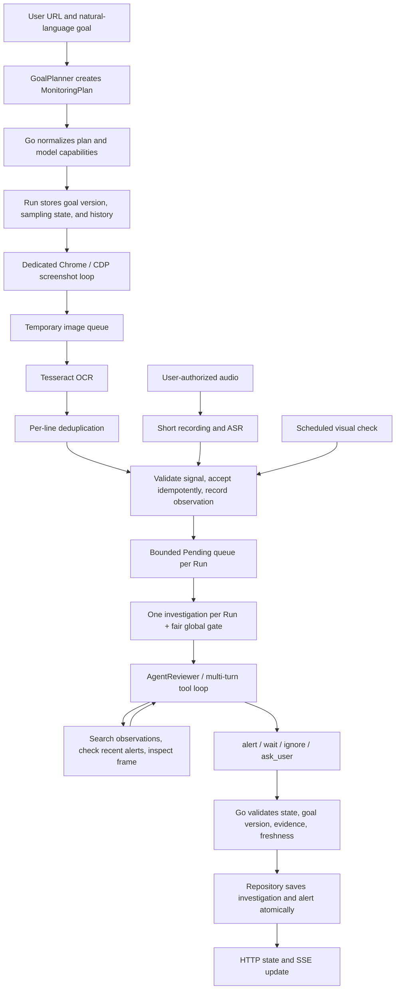

# LiveGuard Architecture: Agent Execution and Evidence

This guide explains why the Agent runs as it does: where the model gets evidence, which actions it can request, how concurrency and freshness are controlled, and how the server validates an alert before saving it. For the folder layout and first end-to-end walkthrough, see the [project guide](PROJECT-GUIDE.en.md).

[English](ARCHITECTURE.en.md) | [简体中文](ARCHITECTURE.md)

## Contents

- [Design goals and constraints](#design-goals-and-constraints)
- [End-to-end execution path](#end-to-end-execution-path)
- [Browser capture without platform-specific APIs](#browser-capture-without-platform-specific-apis)
- [Module interfaces and responsibilities](#module-interfaces-and-responsibilities)
- [One investigation Agent and deterministic pipeline](#one-investigation-agent-and-deterministic-pipeline)
- [Goal planning and model protocols](#goal-planning-and-model-protocols)
- [ReAct investigation and tool permissions](#react-investigation-and-tool-permissions)
- [Complete Harness boundary](AGENT-HARNESS.en.md)
- [Bounded queues and fair scheduling](#bounded-queues-and-fair-scheduling)
- [Evidence rules and alert submission](#evidence-rules-and-alert-submission)
- [Cross-investigation context and persistence](#cross-investigation-context-and-persistence)
- [Sampling policy and cost limits](#sampling-policy-and-cost-limits)
- [Code navigation](#code-navigation)

## Design goals and constraints

The Agent does not run continuously, control the browser directly, or write alerts. It interprets collected evidence within a limited investigation window, calls approved search or vision tools when needed, and proposes a structured conclusion. The Go service owns monitoring, tool permissions, scheduling, state, and final submission.

| Design pressure | Current mechanism | Boundary |
|---|---|---|
| Brief content may appear between screenshots | Separate screenshot loop and OCR pipeline, optional user-authorized ASR, on-demand vision checks | Only captured signals are processed; missed comments cannot be recovered, and no real-source missed-event rate is measured. |
| OCR may be wrong or its source unclear | Keep text boxes, screenshot references, observation time, and source; chat-area goals require OCR plus visual confirmation from the same frame | Coordinates and OCR confidence do not prove that text belongs to chat; quotes, negation, and sarcasm still require semantic judgment. |
| New signals arrive while the model is working | Per-monitor bounded queue, priority aging, deadlines, limited coalescing, global concurrency gate | A full queue can reject work or evict a lower-priority item; retaining an observation does not mean it was investigated. |
| Avoid repeated reviews when nothing changes | OCR line deduplication, review cooldown, on-demand vision and history search, slower cadence in stable states | Deduplication happens after OCR; UI changes may still produce new text. There is no daily currency or token cap. |
| Multiple investigations need continuity | Persisted observation ledger; each investigation can search history and recent alerts | There is no separate event-state ledger; links between “announced,” “started,” “delayed,” and “cancelled” are interpreted during investigation. |
| Long-running monitors can pause, fail, or change goals | Separate Run status, capture health, and investigation state; SQLite persists Pending work while cancellation and goal-version checks protect submission | Valid Pending signals are investigated again after restart; model turns and browser positions do not resume. Observation cleanup is not automatic. |

The main trade-off is to let the model interpret while Go enforces boundaries. Model output can affect a conclusion or sampling proposal, but must pass tool preconditions, evidence checks, and state rules before it can create an alert or change sampling.

## End-to-end execution path

A monitor Run is long-lived. An Investigation is a short process started by a triggering signal and limited by turn and time budgets. One Investigation may make several model requests; a later Investigation rebuilds its input instead of inheriting the previous model conversation.

## Browser capture without platform-specific APIs

Capture starts from an HTTP(S) livestream URL supplied by the user. LiveGuard does not call platform-private APIs or embed a site's DOM structure in the investigation flow. Each monitor has its own Chrome tab; tabs share a dedicated browser process and login profile. The capture module takes screenshots, then all platforms use the same temporary-image, OCR, signal-queue, and Agent workflow.

This reduces platform coupling but has clear limits. The system sees only what the browser currently renders. Expired login, verification challenges, anti-abuse controls, page redesigns, and playback failures affect capture or OCR. LiveGuard does not restore platform accounts or read hidden or not-yet-rendered comments. Users can restrict accessible hosts with `LIVEGUARD_ALLOWED_HOSTS`. In local single-user mode, without this setting any syntactically valid HTTP(S) URL is accepted. Supporting another platform URL does not require changing the Agent, scheduler, OCR semantics, or alert submission.

## Module interfaces and responsibilities

| Module / interface | Current implementation | Responsibility |
|---|---|---|
| `GoalPlanner` | [goal_plan.go](../internal/monitor/goal_plan.go), [agent_goal_planner.go](../internal/monitor/agent_goal_planner.go) | Turn the goal into an inspectable sampling, perception, vision, and alert-scope plan; Go normalizes its limits. |
| `FrameCapturer` / `TextRecognizer` / `Transcriber` | [live_capture.go](../internal/browser/live_capture.go), [capture_pipeline.go](../internal/monitor/capture_pipeline.go), [perception.go](../internal/monitor/perception.go), [minimax_transcriber.go](../internal/monitor/minimax_transcriber.go) | Browser capture, local OCR, and transcription after user authorization; these modules do not maintain event semantics. |
| `Service` | [service.go](../internal/monitor/service.go), [pending.go](../internal/monitor/pending.go) | Run lifecycle, signal admission, Pending queues, investigation permits, cancellation, and pre-submission checks. |
| `UnexpectedEventReviewer` | [agent_reviewer.go](../internal/monitor/agent_reviewer.go), [review_tools.go](../internal/monitor/review_tools.go) | Run a bounded tool loop for one investigation and produce a conclusion and evidence references; it does not write to the Repository. |
| `ToolModel` / `ModelSession` | [model_session.go](../internal/monitor/model_session.go) | Convert shared turns, tool calls, and image content into provider-specific messages. |
| `Repository` | [repository.go](../internal/monitor/repository.go), [sqlite_repository.go](../internal/monitor/sqlite_repository.go) | Atomic reads and bounded state changes for one Run; SQLite is used at runtime, while the in-memory implementation is for temporary runs and tests. |
| `RunLedger` | [ledger.go](../internal/monitor/ledger.go) and repository implementations | Store and paginate the complete observation history separately from the bounded Run snapshot shown in the console. |

Interfaces provide clear replacement points for recognizers, model protocols, and repositories, and tests inject fakes through the same seams. Investigation rules remain in AgentReviewer and Go submission checks instead of being copied into each model adapter. See the [Agent Harness guide](AGENT-HARNESS.en.md) for the full execution boundary and budgets.

## One investigation Agent and deterministic pipeline

Screenshot capture, OCR, speech transcription, and signal persistence have clear inputs and outputs; they do not each need their own ReAct loop. Separate model Agents would move the same signal through more model contexts and handoffs, raising cost and making evidence identity and failure ownership harder to follow. Capture, perception, and scheduling are separate; one Agent handles semantic investigation.

1. **Capture:** a browser adapter takes screenshots at the current interval, records capture time and duration, and sends images through the temporary OCR pipeline.
2. **Perception:** Tesseract returns text, line boxes, and confidence. After the user authorizes audio, a Transcriber turns short clips into signals.
3. **Admission:** Service validates a signal, assigns a receive sequence, records the observation, and decides whether to queue it.
4. **Investigation:** the Agent interprets matches, quotes, negation, tense, and uncertainty using the goal, triggering signal, and limited search results.
5. **Submission:** Go validates state and references again, then saves an Investigation and Alert. The browser does not perform side effects based on model output.

`internal/monitor/runtime.go` contains `Runtime`, the deterministic rule path used without a model. It uses a fixed Planner, ToolExecutor, and Verifier. It handles limited rules; it is not equivalent to an `AgentReviewer` using natural-language context and tools, and does not have the same semantic ability.

## Goal planning and model protocols

When a goal is created or changed, `GoalPlanner` returns a `MonitoringPlan` with OCR cadence, Agent review cadence, visual signals, ASR recommendation, vision policy, alert scope, and tool list. Model planning uses a structured `set_monitoring_plan` tool. `normalizeMonitoringPlan` starts local OCR at one sample per second; runtime adjusts the effective interval based on local processing time. Review cadence is limited to 15/30/60 seconds, and explicit visual requirements are restored from the goal. Deployment setting `LIVEGUARD_LIVE_CAPTURE_INTERVAL` can enforce a slower capture minimum. An ASR recommendation does not start audio capture; the user must authorize it from the monitor card. Planning is one structured call when creating or changing a goal, not a second always-running Agent.

The plan is an inspectable execution policy, not a permission token held by the model:

- The original goal is saved. Projecting model capabilities changes available tools and may add a warning; it does not remove the user's visual goal.
- Users can submit general instructions from the detail page. The latest 10 are retained and included in later Agent context. Submitting an instruction while paused resumes the same monitor; a message starting with “Goal:” changes the goal and replans.
- A goal requiring vision waits for confirmation if the configured model lacks vision. The service does not silently rewrite a visual property into a text match.
- To change a goal, Service prepares and validates a new plan, atomically updates the goal, plan, sampling state, and `GoalVersion`, then invalidates old Pending items and cancels in-flight investigations for the old version.

Model execution uses [`ToolModel`](../internal/monitor/model_session.go) and `ModelSession`. `AgentGoalPlanner` and `AgentReviewer` do not branch by provider. Adapters handle authentication, request/response formats, tool-result encoding, and image encoding. `MessagesModel` handles MiniMax Messages; `ChatCompletionsProvider` handles OpenAI-compatible APIs and DeepSeek.

The seam hides protocol differences, but does not guarantee equivalent model behavior or capabilities. `ModelCapabilities` declares tool calling and vision. Default models have declared vision support; unknown custom models are text-only unless the user overrides the setting. This declaration is not runtime discovery: a request can still fail if the actual model lacks the declared capability. The Chat Completions adapter preserves original assistant fields so providers such as DeepSeek can receive reasoning fields in the next turn. Vision output is normalized as `ModelContent`, then each adapter converts it to that provider's image blocks.

Rule mode runs Go's `Runtime` and does not call model planning, ReAct, or vision tools. Model quota exhaustion and configuration errors are handled by Service and Run state. Do not describe fixed keyword actions as the same thing as a model investigation.

When a browser OCR monitor starts, its first frame gets a “baseline inspection.” The request must return a structured result through `set_live_baseline`. This inspection has its own 20-second deadline and 4,096-token output limit. If the model returns a `max_tokens` truncation, the adapter rejects it, Service marks the baseline unavailable, and none of its proposed plan fields are applied; OCR monitoring continues and the UI shows a readable reason. The output cap limits provider output, not input tokens.

## ReAct investigation and tool permissions

`AgentReviewer.Review` creates a new `ModelSession` for each investigation using the current goal, plan, signal, and limited history. The model can use allowlisted tools to search observations, inspect a frame, propose an alert, or ask the user to define a preference. Go enforces permissions and validates final state. Tool lists, budgets, context limits, and clarification flow are detailed in the [Agent Harness guide](AGENT-HARNESS.en.md) so changeable values are not duplicated.

## Bounded queues and fair scheduling

The asynchronous path separates “signal received” from “investigation completed.” `SubmitSignal` returns after validation and queue admission. The background queue uses the Run's context, so an HTTP client disconnect does not cancel accepted work. Each Run has one `signalQueue` with at most 8 waiting items and one item currently processed by its worker. A Run has at most one investigation in flight; the process has at most 4 concurrent model investigations; at most 8 monitors can be active.

The queue controls pending work; the full observation is recorded at admission:

1. **Freshness:** Text signals normally expire 2 minutes after `ObservedAt`; frames expire after 30 seconds. `ValidUntil` or a recognized countdown/relative time can override this. Expired work is not investigated, but its historical record remains.
2. **Limited coalescing:** A newer background frame replaces an older waiting frame. Identical text from the same source and room within 30 seconds is coalesced. If wording and number positions match but the value changes, the new value replaces the old pending item. Browser OCR also keeps only the latest ordinary-text review trigger per room while preserving every raw observation in the ledger for later search. High-priority cancellation/correction signals are handled separately. Changing numbers do not repeatedly cancel an active investigation; submission still checks newer contradictory evidence.
3. **Priority and aging:** Cancellation/correction starts with higher priority; frames start lower. Each 30 seconds waiting adds one priority level; ties go to the earlier deadline. When full, a high-priority correction can replace a lower-priority waiting item. The replaced observation is still retained.
4. **Overload:** If a regular item cannot enter, Service returns `ErrPendingFull` and rolls back that item's Run-snapshot event and receipt so the caller can retry with the same ID after backpressure clears. Each staged image is at most 4 MiB and all staged images together at most 64 MiB. Rejection, replacement, cancellation, or completion releases Service's temporary copy.

`review_gate.go` manages four global slots and one in-flight investigation per Run. Eligible windows receive permits in waiting order; a window still in cooldown is skipped so it cannot block others. Cooldown is measured from the previous investigation's completion. After a permit is granted, Service reloads the Run and recent alerts, then may replace an ordinary OCR trigger with a newer one received while waiting. A signal with less than 15 seconds remaining does not start an investigation. The refreshed signal retains its own deadline. The monitor context enforces old-goal, pause, and cancellation rules.

Capture and OCR run in separate workers. Each livestream keeps at most one frame waiting for recognition; a newer screenshot replaces the unprocessed one, while an active recognition finishes. At most four regular OCR jobs run process-wide. Each Tesseract process uses one OpenMP thread to avoid taking all Chrome CPU across rooms. Effective sampling is the larger of the configured minimum and recent capture/OCR time; normally it returns to a one-second starting point. Screenshot and DevTools calls honor context deadlines. Temporary failures back off exponentially up to 30 seconds before retrying. A briefly busy state snapshot gets bounded retries rather than causing the capture loop to exit.

Synchronous `Ingest` is kept for compatibility, tests, and synchronous load. It may record an event without queuing a review when cooldown or slot availability prevents immediate work. `SubmitSignal` waits for background execution permission after successful admission until review completes, is cancelled, or expires. Synchronous admission throughput therefore does not represent asynchronous completion throughput or queue latency.

`Waiting/Reviewing/Processed/Failed/Dropped/Expired/Coalesced` are runtime counters. The recoverable work ledger is `pending_signals`: pause and process restart preserve waiting items, and a processing item is reclaimed at startup if it is still current and unexpired. Goal change and stop remove queued work. The exact model request, tool call, and turn are not resumable; recovery restarts investigation from the signal evidence.

## Evidence rules and alert submission

### Signal and evidence identity

[`SignalEvent`](../internal/monitor/domain.go) stores `ID`, room, source, text, OCR line boxes, confidence, `ObservedAt`, `ValidUntil`, receive time, a per-Run `Sequence`, `GoalVersion`, and possibly an archived-image ID. `ObservedAt` is when the content was captured; `Sequence` is when the Repository accepted it. They are not interchangeable. Screenshot OCR uses capture time, not OCR processing time.

- **OCR:** Tesseract recognizes a full screenshot once and returns text with pixel coordinates. Each line is tagged “main screen” or “chat area.” A line is classified as chat when its center lies in the rightmost third and lower three-fifths of the screen; a fixed upper-right notice is classified as main screen. These labels distinguish evidence sources but do not prove meaning. TSV parsing tolerates unescaped quotes so a quote in livestream text does not fail the frame. Before storage, results keep Chinese, Latin letters, digits, and common punctuation. Lines mostly made of other characters, and long lines with extremely low confidence, are discarded. This removes obvious character noise, not semantic incoherence. OCR deduplication keeps at most 512 fingerprints per stream for 30 minutes. It ignores whitespace, punctuation, and region labels. For lines of at least 14 characters, it tolerates one character difference only when digits and sensitive terms such as negation or event-state words are unchanged.
- **Target visibility:** When a plan explicitly lists `PresenceTerms`, capture processing tracks those terms in every successful full-frame OCR result before line deduplication. The first sample establishes a baseline; later transitions from absent to present emit an appearance signal, and three consecutive successful samples without a match emit a disappearance signal. State is in the capture loop only and is reset after a goal version change or process restart. Disappearance means the text is no longer visible in readable screen text; it does not prove delisting, stock status, or physical absence. Non-text objects are not tracked this way.
- **ASR:** Short clips are uploaded only after the user authorizes browser audio sharing. Recording runs alongside up to two transcription requests. A clip is skipped and counted when capacity is full. ASR adds spoken text; it does not locate text on the screen or in chat.
- **Frame:** A sampled or requested screenshot. Its placeholder description is not text recognized from the image and cannot independently support an alert.
- **Vision:** The model's textual interpretation of an image is saved as a visual observation. It remains a model interpretation, not pixel-level automated verification.

Images exist in temporary files only during OCR or the current investigation and are deleted after normal processing. Cleanup after forced termination has not been specifically verified. `inspect_live_frame` can inspect the current temporary screenshot and has a compatibility path for an existing archived image. `save_frame_evidence` does not archive images; it lets the current investigation cite a frame it already inspected and saves related OCR text and textual conclusions. New investigations do not write images to `runtime/frames`.

### Three deduplication mechanisms protect different stages

| Stage | Rule | Not guaranteed |
|---|---|---|
| Input admission idempotency | Same Event ID and fingerprint means retry. Fingerprint uses room, source, text, and confidence; same ID with another fingerprint is a conflict. | Receipts are capped at 2,048 and 24 hours; this is not permanent exactly-once processing. |
| OCR increment | A capture stream normalizes old and new lines and uses a limited one-character comparison; it commits the Preview fingerprint only after downstream admission succeeds. | No general fuzzy semantic match. Numbers and event-state words are preserved so price or negation changes are not swallowed. |
| Alert suppression | Within one room and two minutes, the same normalized summary or original text may suppress a duplicate. Same category alone is not grounds for rejection. | No vector similarity; paraphrases still require Agent context comparison. |

These mechanisms protect request retries, repeated OCR lines, and duplicate alerts; they are not interchangeable. OCR line deduplication does not suppress independent target appearance/disappearance transitions; those signals receive higher pending priority. OCR uses Preview/commit: if the downstream queue rejects a signal, it is not marked as seen, so a retry does not lose evidence that has not been investigated. See [ocr_dedupe.go](../internal/monitor/ocr_dedupe.go), [presence_tracker.go](../internal/monitor/presence_tracker.go), [service.go](../internal/monitor/service.go), and [dedupe.go](../internal/monitor/dedupe.go).

### Investigation and atomic submission

Model calls and tool execution happen outside Repository update transactions. This avoids holding a Run write lock during remote requests, but state and evidence can change while the model works. During one bounded `Repository.Update`, submission checks again:

1. The context is not cancelled and the Run is still `running`.
2. The Investigation's `GoalVersion` is still current.
3. An alert cites 1–6 pieces of evidence actually read in this investigation, all from the current room. `live` evidence is still fresh and belongs to the current goal. `history` evidence requires at least one `scope=all` search, and each cited record must have come from a returned page.
4. A vision-dependent goal was actually checked with vision. For a chat-area goal, cited OCR corresponds to the same observation as the frame actually inspected.
5. No later cancellation, correction, or numeric change with the same wording invalidates the immediate alert, and the alert is not a duplicate.

`create_alert` is a proposal with preconditions; its tool handler does not directly send a notification. After `AgentReviewer` returns, Service saves the Investigation and Alert in an atomic state update. HTTP/SSE then tells the UI that state changed. An outbox transaction for external message delivery is not implemented.

When the goal changes, Service prepares a new plan, atomically updates the goal, plan, sampling state, and `GoalVersion`, then clears old queue items and cancels old investigations. Even if an old model request does not stop promptly, its result cannot be submitted under the new goal. Pause retains the Run and history while cancelling runtime work. Resume rebuilds capture and investigation loops for the same Run. Stop ends the Run.

A Repository `Update` callback must make only bounded in-memory changes; it must not call a model, browser, or network while holding the lock. The default SQLite adapter stores Run snapshots, the complete observation ledger, and Pending signals. On admission, a transaction commits the Run event, observation, and queue item together; rejected admission rolls the whole transaction back. Queue capacity is 8 items per Run, with staged images limited to 4 MiB each and 64 MiB total. A worker claims an item by changing `pending` to `processing` in a transaction and deletes it after normal completion. Pause or process interruption leaves it persisted; startup recovery changes still-valid `processing` items back to `pending`, so Resume starts a new investigation from the saved evidence. Expired items and items from an old GoalVersion are deleted; changing the goal removes old-version items in the same transaction.

SQLite makes local state updates and queue admission consistent, but it cannot restore a model session after a request, a tool-call position, or the browser's internal execution position. If the process exits after an external model result but before its local commit, recovery may call the model again; processing is at-least-once. Runtime JSON storage has been removed. `cmd/monitor-store-export` exports a consistent JSON snapshot and JSONL observation ledger for inspection and archiving; the export does not include Pending items and cannot be loaded back into LiveGuard.

## Cross-investigation context and persistence

Continuity comes from searchable observations and structured business state, not an ever-growing model conversation. Each Investigation creates a new model session. The Agent searches the `RunLedger` on demand for more context. The [Agent Harness guide](AGENT-HARNESS.en.md) describes model-input counts, character budgets, and pagination.

| State / record | Lifetime and purpose |
|---|---|
| `Run` | Stores goal, `GoalVersion`, MonitoringPlan, sampling policy, rooms, recent records, investigations, and alerts. Snapshot history is bounded; `HistoryTruncated` is set after truncation. |
| `RunLedger` | Stores complete OCR/ASR/frame/vision observations and supports paginated search. SQLite and JSON file modes persist it; Memory Repository keeps data only in process. |
| `Pending` | SQLite persists waiting signals and reclaims valid in-flight work after restart; JSON and memory modes keep queue state in process only. |
| `Investigation` | One investigation's state, reason, evidence, tool trace, and token/time metrics. It can wait if evidence is insufficient; a later investigation can search history again. |
| `InvestigationMemory` | Up to 32 Run-scoped notes that expire 24 hours after their evidence; later investigations on the same goal version use them as historical leads, never as current event state or alert evidence. |
| `Alert` | An alert accepted by the backend. Whether a browser user has read it is maintained separately by the frontend; it is not a third-party delivery receipt. |

Run snapshots keep at most 2,000 Events, 500 Investigations, and 500 Alerts. An Investigation keeps at most 100 Evidence items and 64 tool Steps. The full history is separate in `RunLedger`, so trimming the console snapshot does not impose the same limit on observation search. Historical observations and archived images have no automatic cleanup policy, so storage grows.

`InvestigationWaitingUser`, queue `Waiting`, and an event marked “needs confirmation” are different. The first means the investigation asked the user a question; queue waiting means work has not run. There is no separate business state ledger linking announcement, start, delay, and cancellation; these are represented in observations and investigation explanations. Go owns `GoalVersion`, Run state, and context so model memory is not the source of truth.

`InvestigationMemory` is a bounded, expiring note from a completed investigation. It keeps the goal version, room, conclusion, timestamp, and up to three evidence references in the persisted Run snapshot; it is derived without an extra model call. A later investigation receives at most five notes, preferring the same room and newer entries. Updating the goal clears notes from the prior version. The model may use a note to guide history search, but not to prove current status or cite a new alert.

## Sampling policy and cost limits

Costs include screenshots/OCR, optional ASR, text-model requests, and image input. Plan settings express intended cadence. Actual intervals also depend on deployment `captureGap`, global `reviewGap`, screenshot/OCR time, failure backoff, and queue load. A plan interval does not guarantee user-visible alert latency.

- Local OCR starts at one frame per second. The effective interval adjusts to recent screenshot/OCR time, usually 1–10 seconds; deployment settings and failure backoff may slow it further. The perception queue keeps only the latest waiting frame and counts replacements. Agent review has separate 15/30/60-second cooldowns.
- OCR every second does not mean a model call every second. When deduplication finds no new text, that sample normally does not start a text investigation. New text remains subject to Agent review throttling. Scheduled vision checks are separate from OCR cadence.
- OCR deduplication happens after capture, so a UI change can still cause OCR and a model request. If the plan includes visual signals, a scheduled vision check may start an investigation without new OCR text.
- After a successful investigation has read observations and reached confidence of at least 0.72, the model may propose a stable-wait or candidate cadence. Go checks state, time range, consecutive confirmations, and the user goal before applying it. Stable wait can slow Agent review and vision checks to 60 seconds; candidates or near events can raise review cadence to 15 seconds. OCR interval remains limited by local processing capacity. `next_event_at` is not a durable timer and does not guarantee an exact wake-up without new input.
- Each Agent investigation has hard limits on turns, tool calls, and time. There is no cumulative hard budget per Run or per day for tokens, images, ASR minutes, or money. An image inspected once may be sent again in later model turns.

See [sampling.go](../internal/monitor/sampling.go), [capture_pipeline.go](../internal/monitor/capture_pipeline.go), and [review_gate.go](../internal/monitor/review_gate.go) for policy and transitions. Use observed runtime intervals and durations for capture measurements, not just plan configuration.

## Code navigation

| Mechanism | Entry points |
|---|---|
| Process wiring and runtime modes | [cmd/liveguard/main.go](../cmd/liveguard/main.go), [service.go](../internal/monitor/service.go) |
| Goal plan and model capabilities | [goal_plan.go](../internal/monitor/goal_plan.go), [agent_goal_planner.go](../internal/monitor/agent_goal_planner.go), [model_config.go](../internal/monitor/model_config.go) |
| ReAct loop and tool protocol | [internal/agent/loop.go](../internal/agent/loop.go), [agent_reviewer.go](../internal/monitor/agent_reviewer.go), [review_tools.go](../internal/monitor/review_tools.go), [review_context.go](../internal/monitor/review_context.go) |
| Queue, freshness, and fair concurrency | [pending.go](../internal/monitor/pending.go), [signal_policy.go](../internal/monitor/signal_policy.go), [review_gate.go](../internal/monitor/review_gate.go) |
| Evidence sources and submission checks | [evidence.go](../internal/monitor/evidence.go), [service.go](../internal/monitor/service.go), [repository.go](../internal/monitor/repository.go) |
| Observation ledger and history search | [ledger.go](../internal/monitor/ledger.go), [sqlite_repository.go](../internal/monitor/sqlite_repository.go) |
| Provider adapters and retries | [model_session.go](../internal/monitor/model_session.go), [messages_model.go](../internal/monitor/messages_model.go), [chat_completions_provider.go](../internal/monitor/chat_completions_provider.go), [retry.go](../internal/agent/retry.go) |
