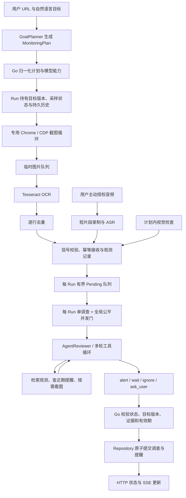

# LiveGuard 架构：Agent 执行与证据链

[English](ARCHITECTURE.en.md) | 简体中文

本文聚焦 Agent 为什么以当前方式运行：模型从哪里获得证据、能够调用什么、并发和时效由谁控制，以及提醒如何经过服务端校验后提交。目录、术语和一次监控的入门路线见[项目导览](PROJECT-GUIDE.md)。

## 目录

- [设计目标与约束](#设计目标与约束)
- [端到端执行路径](#端到端执行路径)
- [平台无关的浏览器采集](#平台无关的浏览器采集)
- [模块接口与职责](#模块接口与职责)
- [一个调查 Agent 与确定性流水线](#一个调查-agent-与确定性流水线)
- [目标规划与模型协议](#目标规划与模型协议)
- [ReAct 调查与工具权限](#react-调查与工具权限)
- [Agent Harness 的完整边界](AGENT-HARNESS.md)
- [有界队列与公平调度](#有界队列与公平调度)
- [证据规则与提醒提交](#证据规则与提醒提交)
- [跨调查上下文与持久化](#跨调查上下文与持久化)
- [采样策略与成本边界](#采样策略与成本边界)
- [代码导航](#代码导航)

## 设计目标与约束

LiveGuard 的 Agent 不负责持续运行，也不直接控制浏览器或写入提醒。它在一个有限的调查窗口内解释已采集的证据，按需调用只读检索或视觉工具，并提出结构化结论。Go 服务管理持续监控、工具权限、任务调度、状态和最终提交。

| 设计压力 | 当前机制 | 保证边界 |
|---|---|---|
| 短暂内容可能落在截图间隔里 | 独立截图循环、OCR 流水线、可选授权 ASR、按需视觉采样 | 只处理采集到的信号；无法找回未采到的评论，也没有真实源端漏采率指标 |
| OCR 文本可能错字或来源不明 | 保留行框、截图引用、观测时间和来源；聊天区目标要求 OCR 与同一截图的视觉确认 | 坐标和 OCR 置信度不能证明文字属于聊天区；引用、否定、反讽仍要语义判断 |
| 模型处理期间新信号继续到达 | 每监控有界等待队列、优先级老化、deadline、有限合并和全局并发门控 | 队列满会拒绝或淘汰低优先级待处理项；观测留存不代表调查完成 |
| 无变化时不应反复启动判断 | OCR 行去重、调查节流、按需看图与历史检索、稳定状态降频 | 去重发生在 OCR 之后；UI 变化仍可能产出新文本并触发调查；没有每日金额或 token 总预算 |
| 多次调查需要连续性 | 观测流水持久化；每次调查按需搜索历史观测和近期提醒 | 没有独立事件状态账本；“预告、开始、延期、取消”之间的关系仍由调查解释 |
| 长时间运行中会暂停、失败或改目标 | Run 状态、采集健康和单次调查状态分开；取消上下文和目标版本校验保护提交 | 队列和在途调查是进程内状态，重启不恢复精确执行位置；观测和归档图片没有自动清理 |

核心取舍是让模型负责解释、让 Go 负责约束。模型输出可以影响调查结论和采样建议，但必须经工具前置条件、证据校验和状态提交规则才能产生提醒或改变采样节奏。

## 端到端执行路径

监控 Run 是长生命周期对象；Investigation 是由一条触发信号启动、受轮次和时间预算约束的短生命周期过程。一次 Investigation 可以发起多轮模型请求，但下一次 Investigation 会重新构建输入，不会自动继承上一轮的模型对话。

## 平台无关的浏览器采集

浏览器采集以用户提供的 HTTP(S) 直播 URL 为入口，不调用某个平台的私有接口，也不把站点 DOM 结构写进调查流程。每个监控保留自己的 Chrome 标签页，但共享专用浏览器进程和登录配置；采集器只负责在各自页面截图，之后统一经过临时图片、OCR、信号队列和 Agent 调查。不同平台的多个直播间因此走同一条后端工作流。

这个边界换取了较低的平台接入耦合，也带来明确限制：系统看到的是浏览器当前渲染出的画面，登录失效、验证码、风控提示、页面改版和播放失败都会影响截图或 OCR；它不会自动恢复平台账号，也不能读取被页面隐藏或尚未渲染的评论。用户可用 `LIVEGUARD_ALLOWED_HOSTS` 限制浏览器可访问的主机；本地单用户运行未设置时接受任何语法有效的 HTTP(S) URL。新增平台 URL 不需要改 Agent、调度器、OCR 语义或提醒提交逻辑。

## 模块接口与职责

| 模块 / 接口 | 当前实现 | 负责的规则 |
|---|---|---|
| `GoalPlanner` | [`goal_plan.go`](../internal/monitor/goal_plan.go)、[`agent_goal_planner.go`](../internal/monitor/agent_goal_planner.go) | 把用户目标转成可检查的采样、感知、视觉与提醒范围计划；Go 归一化计划边界 |
| `FrameCapturer` / `TextRecognizer` / `Transcriber` | [`live_capture.go`](../internal/browser/live_capture.go)、[`capture_pipeline.go`](../internal/monitor/capture_pipeline.go)、[`perception.go`](../internal/monitor/perception.go)、[`minimax_transcriber.go`](../internal/monitor/minimax_transcriber.go) | 浏览器取帧、本地 OCR、用户授权后的语音转写；不维护事件语义状态 |
| `Service` | [`service.go`](../internal/monitor/service.go)、[`pending.go`](../internal/monitor/pending.go) | Run 生命周期、信号接收、Pending 队列、调查许可、取消与提交前校验 |
| `UnexpectedEventReviewer` | [`agent_reviewer.go`](../internal/monitor/agent_reviewer.go)、[`review_tools.go`](../internal/monitor/review_tools.go) | 对一个调查窗口运行有限工具循环，生成结论和证据引用；不直接写 Repository |
| `ToolModel` / `ModelSession` | [`model_session.go`](../internal/monitor/model_session.go) | 模型协议接缝：把统一轮次、工具调用和图片内容转换成提供方消息格式 |
| `Repository` | [`repository.go`](../internal/monitor/repository.go)、[`file_repository.go`](../internal/monitor/file_repository.go) | 对单个 Run 做原子读取和有界状态变更；实现分别对应内存和本地文件 |
| `RunLedger` | [`ledger.go`](../internal/monitor/ledger.go) 及各 Repository 实现 | 保存和分页检索完整观测；与 Run 快照中用于控制台显示的有界记录分开 |

这些接口把会变化的能力放在明确接缝上：感知器可替换，模型协议由 Adapter 转换，Repository 可替换；测试也从同一接口注入假实现。调查规则仍集中在 `AgentReviewer` 与 Go 提交校验中，没有复制到每个模型 Adapter。完整 Agent Harness 的分层职责与执行预算见[Agent Harness 详解](AGENT-HARNESS.md)。

## 一个调查 Agent 与确定性流水线

截图、OCR、音频转写和信号持久化有清晰输入输出，不需要各自运行 ReAct。独立的语言模型 Agent 会让同一条信号跨多段模型上下文和状态交接，增加调用成本，也让证据身份和失败归属更难判断。因此采集、感知、调度、语义调查分开执行，而调查语义由一个 Agent 统一承担。

职责边界如下：

1. **采集**：浏览器 Adapter 按当前间隔截图，记录捕获时间和采集耗时；只把图片放入临时 OCR 流水。
2. **感知**：Tesseract 输出文本、行框和置信度；用户授权音频后，Transcriber 将短音频片段转成独立信号。
3. **接收**：Service 校验信号、分配接收序号、记录观测并决定是否进入异步队列。
4. **调查**：Agent 根据用户目标、触发信号和有限检索结果解释命中、引用、否定、时态与不确定性。
5. **提交**：Go 再次验证状态和引用，写入 Investigation/Alert；浏览器不会因模型输出而直接执行副作用。

`internal/monitor/runtime.go` 中的 `Runtime` 是无模型时的确定性规则路径，使用固定 Planner、ToolExecutor 和 Verifier。它处理有限规则，不能等同于基于自然语言上下文调用工具的 `AgentReviewer`，也不具备相同的语义能力。

## 目标规划与模型协议

新建或修改目标时，`GoalPlanner` 输出 `MonitoringPlan`，包含 OCR 采样、Agent 复核、视觉信号、是否建议 ASR、视觉策略、提醒范围和工具清单。模型规划走结构化 `set_monitoring_plan` 工具；`normalizeMonitoringPlan` 将本地 OCR 起点设为每秒一次，运行时再按本机处理耗时调整有效间隔；复核节奏限制在 15/30/60 秒，并依据目标补回明确视觉要求。部署级 `LIVEGUARD_LIVE_CAPTURE_INTERVAL` 可以设定更慢的采集下限。ASR 只表示建议，实际启动仍需要用户在监控卡片授权。这个规划是创建或改目标时的一次结构化调用，不是常驻的第二个自主 Agent。

计划是检查和执行策略，不是模型直接持有的权限：

- 用户目标作为原始意图保存；模型能力投影只调整可用工具和能力警告，不删除用户的视觉目标。
- 用户可在监控详情持续提交通用指令；指令会保留最近 10 条并进入后续 Agent 判断上下文。暂停时提交指令会继续同一监控；以“目标：”开头的指令会更新目标并重做计划。
- 需要看图的目标在不支持视觉的模型下等待确认；服务端不会把“画面属性”静默改写成文字匹配。
- 修改目标时，先生成并校验新计划，再在 Repository 更新中递增 `GoalVersion` 并重置采样状态，随后取消旧版本的 Pending 和在途调查。

模型执行统一经过 [`ToolModel`](../internal/monitor/model_session.go) 与 `ModelSession`。`AgentGoalPlanner` 和 `AgentReviewer` 不按提供方分叉；Adapter 只负责鉴权、请求/响应格式、工具结果回传和图片编码。`MessagesModel` 处理 MiniMax Messages 协议；`ChatCompletionsProvider` 处理 OpenAI 兼容协议及 DeepSeek。

这个接缝隐藏了消息协议差异，但不保证模型行为或能力相同。`ModelCapabilities` 显式声明工具调用和图片能力；默认模型有已声明的视觉能力，未知自定义模型按文字模型处理，也可由用户设置覆盖。能力声明不是运行时探测：若实际模型不支持声明的能力，请求仍可能失败。Chat Completions Adapter 会保留原始 assistant 消息字段，以便 DeepSeek 等提供方在下一轮继续接收其推理字段；视觉输出先统一为 `ModelContent`，再由 Adapter 转成各自协议的图片块。

规则模式由 Go 的 `Runtime` 执行，不会调用模型规划、ReAct 或看图工具。模型额度耗尽、配置错误等状态由 Service/运行状态处理；不能把规则模式的固定关键词动作和模型 Agent 的调查轨迹混为一谈。

浏览器 OCR 监控启动后会用首帧做一次“初看”，请求必须通过 `set_live_baseline` 返回结构化结果。初看单独使用 20 秒时限和 4,096-token 输出上限，与调查轮次一致；提示词限制摘要和区域列表长度，减少无关输出。若模型仍返回 `max_tokens` 截断，Adapter 会拒绝该回复，Service 将初看标为不可用，不应用其中任何计划字段，OCR 监控继续运行；页面显示可读原因。该输出上限是提供方的回复限制，不是输入上下文 token 预算。

## ReAct 调查与工具权限

`AgentReviewer.Review` 为每条调查创建新的 `ModelSession`，从当前目标、计划、信号和有限历史开始判断。模型通过白名单工具检索观测、按需看图、提出提醒或请求用户定义偏好；Go 服务负责执行权限检查并校验最终状态。工具清单、单次调查预算、上下文边界和用户补充流程统一维护在[Agent Harness 详解](AGENT-HARNESS.md)，避免在两份文档中重复列出易变的限制值。

## 有界队列与公平调度

异步路径把“收到信号”和“完成调查”拆开。`SubmitSignal` 在校验和入队后返回；后台队列使用 Run 自己的 context，因此 HTTP 客户端断开不会取消已接收工作。每个 Run 一个 `signalQueue`，最多保留 8 条等待项，另有至多一条当前由该队列 worker 处理的项。每个 Run 至多一个调查在途，全进程最多 4 个模型调查并发；活跃监控上限为 8 个。

队列只控制待调查工作，完整观测在接收阶段已经记录。队列操作顺序和影响如下：

1. **有效期**：默认文字信号从 `ObservedAt` 起 2 分钟，frame 信号 30 秒；可由 `ValidUntil` 或可识别的倒计时/相对时间覆盖。过期项不再调查，但历史记录不随之删除。
2. **有限合并**：替换等待中的背景 frame；同来源、同房间、30 秒内完全相同的文字合并；句式和数字位置相同但数值变化时，新值替代旧的待处理项。浏览器连续 OCR 另有合并策略：同房间普通文字只保留一个最新待复核触发，全部原始观测仍写入流水，Agent 可按目标和时间检索。取消、更正等高优先级信号单独处理。直播数值刷新不会反复取消正在执行的调查，提交时仍检查较新的反证。
3. **优先级与老化**：取消/更正等文字有较高初始优先级，frame 较低；每等待 30 秒增加一级，同分按更早 deadline 先处理。满队列时，高优先级转折可替换尚未达到同级的低优先级项；被替换的观测仍保留。
4. **过载行为**：普通项目无法入队时返回 `ErrPendingFull`；Service 撤销该项目的 Run 快照事件和回执，让相同 ID 可在背压解除后重试。图片每项最多 4 MiB、所有暂存图片总计最多 64 MiB；拒绝、替换、取消或处理结束都会释放 Service 自己的临时副本。

全局 `review_gate.go` 管理 4 个槽位和每 Run 单飞：可运行窗口按等待顺序获得许可；尚在复核冷却期的窗口暂时跳过，以免阻塞其他窗口。冷却从上次调查完成计算，避免慢调查结束后立刻再开一轮。Run 内部队列选择下一项时使用优先级与 deadline。获得许可后 Service 重新读取 Run 和提醒，并用等待期间最新的普通 OCR 触发替换旧触发；剩余有效期少于 15 秒的信号不启动调查。刷新后的信号仍使用自己的有效期，旧目标、暂停与取消继续通过监控 context 约束。

采集与 OCR 使用独立工作循环，每个直播间最多保留一张待识别画面；新截图替换尚未识别的旧截图，正在识别的画面正常完成。全进程最多并发 4 个常规 OCR，每个 Tesseract 子进程限制为 1 个 OpenMP 线程，防止多路 OCR 抢占 Chrome 的全部 CPU。有效采样间隔取配置下限与最近截图/OCR 耗时的较大值，正常时恢复到 1 秒起点。截图与 DevTools 连接遵守 context 超时；临时失败指数退避至最多 30 秒后继续尝试。状态快照短暂被占用时先有限重试，仍失败也不直接退出采集循环。

同步 `Ingest` 为兼容、测试和同步负载入口：事件仍可被记录，但因冷却或没有可用槽位而未启动的调查不会留在异步队列等待。`SubmitSignal` 则为成功入队的信号等待后台执行许可，直到调查完成、被取消或 deadline 到期。因此同步接收吞吐不代表异步队列的完成吞吐或排队延迟。

队列状态 `Waiting/Reviewing/Processed/Failed/Dropped/Expired/Coalesced` 是当前进程的执行状态，不是可恢复的任务账本。暂停、停止或改目标会关闭/清理旧队列并取消在途 context；服务重启不会从 Pending 精确恢复未完成工作。

## 证据规则与提醒提交

### 信号与证据身份

[`SignalEvent`](../internal/monitor/domain.go) 保存 `ID`、房间、来源、文本、OCR 行框、置信度、`ObservedAt`、`ValidUntil`、接收时刻、单 Run 的 `Sequence`、`GoalVersion` 及可能的图片归档 ID。`ObservedAt` 表示感知内容对应的采集时间；`Sequence` 表示 Repository 接收顺序，两者不等价。截图的 OCR 时间使用捕获时间，不把 OCR 处理耗时当成内容发生时间。

- **OCR**：Tesseract 对完整截图做一次行级识别，返回文字和像素坐标；每行按坐标标记为 `《主屏幕》` 或 `《聊天区》`。中心点位于屏幕宽度右侧三分之一、且高度下方五分之三的行标作聊天区；右上固定提示归入主屏幕。位置标签用于区分证据来源，不证明文字语义。TSV 解析允许未转义引号，避免直播文字中的 `"` 让整帧识别失败；识别结果入库前只保留中文、拉丁字母、数字和常见标点，若一行主要由其他字符组成则丢弃，极低置信度且较长的行也会过滤。此规则能清除明显字符噪声，不能判断一串合法中英文是否语义通顺。每条采集流的 OCR 去重最多保留 512 个指纹、窗口为 30 分钟；忽略空白、标点和区域标签，对长度至少 14 的行仅在数字及否定/事件状态等敏感词签名不变时容忍一个字符差异。
- **ASR**：只有用户授权分享网页音频后才上传短片段。录音与最多两个在途转写请求并行；容量不足会跳过片段并计数。它补充口播文字，不提供画面或聊天区定位。
- **frame**：表示一次截图采样或待检查画面。frame 的提示文案不是从图片中识别出的事件文字，不能独立支撑提醒。
- **vision**：模型看图后形成的文本解释，作为新的视觉观测留存；它仍是模型解释，不能当作像素级自动验证结果。

图片只在 OCR 识别或当前调查看图时放在临时文件中，正常处理结束后删除；进程被强制终止后的临时文件清理尚未专项验证。`inspect_live_frame` 可以检查当前临时截图，也保留读取已有归档截图的入口。`save_frame_evidence` 不会归档图片；它只允许当前调查把已经检查过的图片作为判断依据，并保存相关 OCR 文字和文字结论。新调查不会把图片写入 `runtime/frames`。

### 三种去重各自保护不同阶段

| 阶段 | 规则 | 不保证什么 |
|---|---|---|
| 输入接收幂等 | 相同 Event ID + 相同指纹视为重试；指纹由房间、来源、文本和置信度构成，同 ID 不同指纹返回冲突 | 回执最多 2,048 条且最多保留 24 小时，不是永久 exactly-once |
| OCR 增量 | 单采集流对新旧行做规范化与有限的一字差异比较；仅在信号成功进入下游后提交 Preview 指纹 | 不做通用模糊语义匹配；保留数字和事件状态词，防止价格或否定变化被吞 |
| 提醒抑制 | 同房间两分钟内相同归一化摘要或原文可抑制重复提醒；类别相同本身不足以拒绝 | 不计算向量相似度；同义改写仍需要 Agent 比较上下文 |

这些去重分别作用于“请求重试”“重复 OCR 行”和“重复用户提醒”，不能相互替代。特别是 OCR 去重使用 Preview/commit：如果下游队列拒绝新信号，不先把它记录为已见，避免重试时丢失尚未调查的证据。实现见 [`ocr_dedupe.go`](../internal/monitor/ocr_dedupe.go)、[`service.go`](../internal/monitor/service.go)、[`dedupe.go`](../internal/monitor/dedupe.go)。

### 调查与原子提交

模型调用和工具执行发生在 Repository 更新事务之外。这样远程请求不会占用 Run 的写锁；代价是模型工作期间状态和证据都可能变化。提交阶段在一次受限的 `Repository.Update` 中重新检查：

1. context 尚未取消且 Run 仍处于 `running`；
2. Investigation 使用的 `GoalVersion` 仍是当前版本；
3. 提醒决策带 1–6 条本次实际读取的证据，且同属当前房间；`live` 证据仍在有效期内、属于当前目标；`history` 证据要求本次调查至少调用过一次 `scope=all`，被引用的记录仍须来自实际返回的页面；
4. 依赖视觉的目标确实成功看图；聊天区目标引用的 OCR 与本次实际检查的同一观测对应；
5. 没有更晚到达的取消、更正或同句式数值变化使旧的即时提醒失效，且没有重复提醒。

`create_alert` 是一项经过前置条件校验的提醒提案，不在模型工具 Handler 内直接向用户发送通知。`AgentReviewer` 返回决定后，Service 在原子状态更新中创建 Investigation 和 Alert；HTTP/SSE 再通知网页状态变化。外部消息投递的事务 outbox 不在当前实现中。

改目标时先准备新计划，再原子更新用户目标、计划、采样状态和 `GoalVersion`，之后清空旧队列并取消旧调查。即使旧模型请求不及时响应，它的结果也无法在新目标下提交。暂停会保留 Run 与历史并取消运行时；继续时以同一 Run 重建采集/调查循环。停止则结束 Run。

Repository `Update` 回调必须只执行有界的内存状态变更，不应在锁中调用模型、浏览器或其他网络。Memory Repository 用互斥锁和副本；文件 Adapter 在内存仓储逻辑上持久化快照与观测追加记录。它们保护 Repository 内状态更新的一致性，不构成跨进程任务队列或外部副作用的 exactly-once。

## 跨调查上下文与持久化

连续性来自可查询的观测和结构化业务状态，不来自持续增长的模型对话。每次 Investigation 新建模型会话；Agent 需要额外上下文时按需查询 RunLedger。模型输入的具体条数、字符预算与分页限制见[Agent Harness 详解](AGENT-HARNESS.md)。

| 状态/记录 | 生命周期和用途 |
|---|---|
| `Run` | 保存目标、`GoalVersion`、MonitoringPlan、采样策略、房间、近期记录、Investigation 和 Alert；快照中的历史有上限，超过后设置 `HistoryTruncated` |
| `RunLedger` | 保存完整 OCR/ASR/frame/视觉观测并按页检索；文件模式跨进程保存，Memory Repository 仅在当前进程保留 |
| `Pending` | 进程内等待和执行信息；不是持久任务状态，重启后不会恢复排队位置 |
| `Investigation` | 一次调查的状态、原因、证据、工具轨迹和 token/耗时；证据不足可以等待，后续调查通过搜索历史重新核验 |
| `Alert` | 后端已经接受的提醒记录；浏览器是否已读由前端另行维护，不表示第三方送达回执 |

Run 快照中的 Event 最多 2,000 条、Investigation/Alert 各最多 500 条；单次 Investigation 的 Evidence 最多 100 条、工具 Steps 最多 64 条。完整观测由 `RunLedger` 分开提供，所以控制台快照裁剪不等于观测检索也被截成相同上限。当前历史观测和归档图片没有自动清理策略，长期存储量会增长。

`InvestigationWaitingUser`、队列 `Waiting` 和事件“待确认”不是同一个状态：前者表示调查已经向用户提出问题；队列等待只表示尚未执行；事件的预告、开始、延期、取消关系并没有单独的业务状态账本，而是保存在观测和调查解释中。`GoalVersion`、Run 状态和 context 由 Go 管理，避免模型记忆成为状态真相。

## 采样策略与成本边界

成本由截图/OCR、可选 ASR、文字模型请求和图片输入共同构成。计划参数是期望节奏，运行间隔还受部署级 `captureGap`、全局 `reviewGap`、截图/OCR耗时、失败退避和队列负载影响。计划间隔不能解释成用户端提醒时延保证。

- 本地 OCR 以每秒采样为起点，有效间隔按最近截图/OCR耗时调整至 1–10 秒，部署配置和故障退避可再放慢；感知队列只保留最新等待画面并记录替换数量。Agent 调查使用独立的 15/30/60 秒冷却。
- OCR 每秒运行不代表 Agent 每秒调用模型。OCR 行去重后没有新增文字，通常不会因该次采样发起文字调查；新的文本信号进入队列后仍受 Agent 复核节流。周期视觉检查也独立于 OCR 频率。
- OCR 去重后没有新增文字，通常不会因该次采样发起文字调查；如果计划包含视觉信号，到期视觉检查仍可能产生调查。OCR 之后才发现文字变化，因此 UI 变化仍可能触发 OCR 和模型请求。
- 成功调查读取过观测且置信度至少 0.72 时，模型可提出稳定等待或候选建议；Go 校验状态、时间范围、连续次数和用户目标后才应用。稳定等待可以把 Agent 复核和视觉检查放慢至 60 秒，候选/临近事件可把复核提至 15 秒；OCR 有效间隔由本机处理能力约束。`next_event_at` 不是持久定时器，没有新输入时不保证准点唤醒。
- 单次 Agent 调查的轮次、工具次数和时间有硬限制；当前没有每 Run 或每日 token、图片、ASR 时长、金额的累计硬预算。一次检查的图片也可能随之后模型轮次再次发送。

实际策略与状态转换见 [`sampling.go`](../internal/monitor/sampling.go)、[`capture_pipeline.go`](../internal/monitor/capture_pipeline.go) 和 [`review_gate.go`](../internal/monitor/review_gate.go)。采集指标应以运行中观测到的间隔和耗时为准，而不是只读计划配置。

## 代码导航

| 想追踪的机制 | 阅读入口 |
|---|---|
| 进程装配与运行模式 | [`cmd/liveguard/main.go`](../cmd/liveguard/main.go)、[`internal/monitor/service.go`](../internal/monitor/service.go) |
| 目标计划与模型能力投影 | [`goal_plan.go`](../internal/monitor/goal_plan.go)、[`agent_goal_planner.go`](../internal/monitor/agent_goal_planner.go)、[`model_config.go`](../internal/monitor/model_config.go) |
| ReAct 循环和工具协议 | [`internal/agent/loop.go`](../internal/agent/loop.go)、[`agent_reviewer.go`](../internal/monitor/agent_reviewer.go)、[`review_tools.go`](../internal/monitor/review_tools.go)、[`review_context.go`](../internal/monitor/review_context.go) |
| 队列、时效、公平并发 | [`pending.go`](../internal/monitor/pending.go)、[`signal_policy.go`](../internal/monitor/signal_policy.go)、[`review_gate.go`](../internal/monitor/review_gate.go) |
| 证据来源和提交约束 | [`evidence.go`](../internal/monitor/evidence.go)、[`service.go`](../internal/monitor/service.go)、[`repository.go`](../internal/monitor/repository.go) |
| 观测流水与长期查询 | [`ledger.go`](../internal/monitor/ledger.go)、[`file_repository.go`](../internal/monitor/file_repository.go) |
| Provider Adapter 与重试 | [`model_session.go`](../internal/monitor/model_session.go)、[`messages_model.go`](../internal/monitor/messages_model.go)、[`chat_completions_provider.go`](../internal/monitor/chat_completions_provider.go)、[`retry.go`](../internal/agent/retry.go) |
