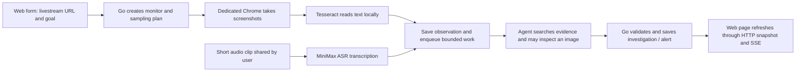
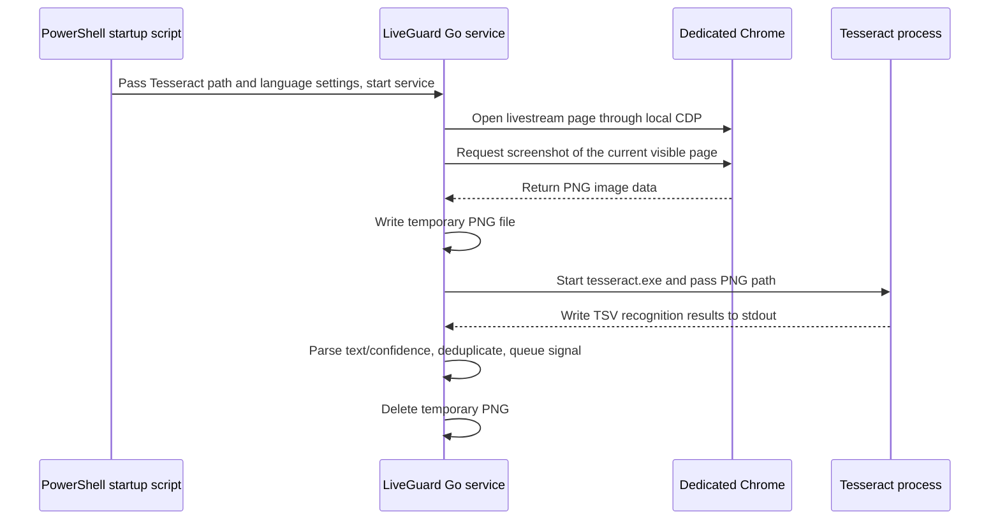
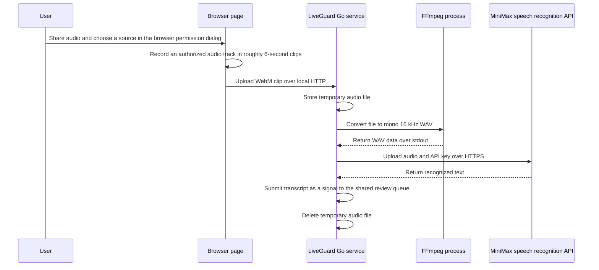

# LiveGuard Project Guide: From Folders to an Alert

This guide walks a first-time developer through the project. After reading it, you should know where code lives, how a monitor goes from the web page to an alert, which state Go owns, where the model is constrained, and what current tests can prove.

Here, an “Agent” is a model program that chooses from limited tools using context, then continues based on tool results. It is not a robot with unrestricted access to the computer. The Go service owns capture scheduling, permissions, state changes, and final submission. The model provides bounded interpretation and suggestions.

[English](PROJECT-GUIDE.en.md) | [简体中文](PROJECT-GUIDE.md)

## The whole system at a glance

LiveGuard continuously does three things: watches a livestream page, turns what it sees into text or visual signals, and decides whether a signal merits an alert. It cannot see content that appears and disappears between samples. “Continuous monitoring” means the task keeps running; it does not mean every video frame is inspected.

OCR means optical character recognition: reading text from an image. ASR means automatic speech recognition: turning audio that the user authorized into text. SSE is a server-sent connection held open by the web page. LiveGuard uses it to tell the page to refresh; the monitor details themselves are read through HTTP APIs.

## Folder map

| Path | What it contains | Where to start |
|---|---|---|
| `cmd/liveguard/main.go` | Executable entry point: reads settings, chooses storage, wires services, starts HTTP, shuts down cleanly | Read `main` to see how components are connected; business rules are elsewhere. |
| `cmd/monitor-eval/main.go` | Runs the fixed text-evaluation command with configured MiniMax and writes a JSON report | Check command options and exit conditions. |
| `cmd/monitor-load/main.go` | Runs synthetic signal-load measurements and writes a JSON report | Note the explicit mock/no-capture label. |
| `internal/domain` | Shared event IDs and web-push event types | Not livestream decision logic. |
| `internal/agent` | Business-independent model/tool loop, HTTP client, limited retries, and circuit breaker | Start with `loop.go` to see how model actions are bounded. |
| `internal/browser` | Dedicated Chrome session, livestream URL validation, and DevTools screenshot capture | Start with `live_capture.go` for the real capture entry point. |
| `internal/monitor` | Core business: monitor state, queues, evidence, model adapters, tools, repositories, and evaluation code | Follow the call path below, then inspect specific files. |
| `internal/web` | HTTP API, SSE, local static web assets, and request validation | Read routes in `server.go`; `static/` contains the web page. |
| `internal/telemetry` | Optional OTLP trace-export setup | See the operations guide for current observability scope. |
| `scripts` | Windows quick start, explicit model checks, and manual-acceptance exports | Scripts can call paid APIs; read comments before use. |
| `docs` | Architecture, operations, evaluation, risk, and project guides | Start with this page. |
| `runtime` | Local state, browser profile, and runtime image evidence | Do not commit it; see the operations guide for retention. |

`internal` is a Go convention: these packages are implementation details and are not promised as stable external library interfaces. `cmd` contains entry points for starting programs. Shared rules belong in `internal` so the web server, tests, and command-line tools can reuse them.

## Core terms in everyday language

| Term | Meaning in LiveGuard | Common confusion |
|---|---|---|
| **Run (monitor session)** | One ongoing task created by a user, with a goal, plan, state, history, and alerts | A Run can last a long time; it is not one model judgment. |
| **Room (livestream window)** | A livestream page watched by a Run; currently each Run has one Room | It is not a separate account or model session. |
| **Signal / Event (observation)** | One input record recognized at a particular time from OCR, ASR, or a frame | It records “what was observed,” not necessarily “what happened.” |
| **Evidence** | An observation or inspected image cited by an investigation, with source, time, and goal version | OCR text does not prove it came from chat. |
| **Investigation** | One bounded Agent judgment triggered by an observation, with conclusion and tool steps | A failed investigation does not mean the whole Run failed. |
| **Alert** | A reminder record saved to the Run after Go validation | Marking it read in the web page does not delete it from the backend. |
| **Pending** | In-process counts for work waiting, reviewing, or completed | It is not a job checkpoint that can be resumed from a database after restart. |
| **GoalVersion** | A number incremented whenever the user changes the monitoring goal | It prevents a late result for an old goal from changing the new goal. |
| **Repository** | A storage interface for Runs and observations | Memory storage lasts only for the process; JSON file mode writes locally. |
| **Harness (execution framework)** | The layers that run one controlled Agent investigation; `internal/agent/loop.go` is the generic turn/tool kernel | The kernel does not understand livestream semantics; Monitor supplies domain tools, async scheduling, and final checks. See the [Agent Harness guide](AGENT-HARNESS.en.md). |

Run status, capture health, and one investigation's status are three separate state lines. A Run can still be `running` while its Room reports `needs_login`; one Investigation can be `failed` while the monitor keeps accepting future signals. This separation answers “is the task open?”, “is capture healthy?”, and “did this judgment finish?”

## One monitor from start to finish

### 1. The web page creates a task

The page sends a livestream URL, monitoring goal, and capture mode to `POST /api/monitors`. `internal/web/server.go` limits request size and performs basic validation before calling `monitor.Service.Start`. The service validates the URL, goal length, and mode again, and limits the number of active monitors to 8.

Capture modes:

- `browser_ocr`: starts real Chrome screenshot capture and OCR; Chrome and Tesseract must be configured.
- `ocr_upload`: accepts an image from an API or the user, then runs OCR.
- `demo_replay`: feeds fixed synthetic signals for demonstration. It is not evidence of real-time capture.

The default mode is `demo_replay`. A reminder on the demo page does not prove Chrome login, screenshots, or OCR are working.

### 2. The goal becomes a bounded plan

`GoalPlanner` converts the natural-language goal into a `MonitoringPlan`, such as capture interval, whether to inspect images, and whether the user cares about the whole page or the chat area. LLM means large language model. If model planning fails, Service falls back to a local Go default plan and then normalizes its scope again. The model proposes a plan, but cannot set an interval outside the Go limits.

The plan answers “how should we observe?” It is not itself an event judgment. Providers (MiniMax, OpenAI-compatible endpoints, DeepSeek) use the shared `ToolModel` / `ModelSession` seam. Business decisions should not be scattered across provider HTTP adapters.

### 3. Service creates the Run and starts runtime work

A Run starts as `running`, its goal version starts at 1, and the Room's capture health starts as `waiting_signal`. Service saves the Run, creates a background context and Pending queue, then starts demo replay or browser capture according to the mode.

A Go `context` carries whether work may continue. On pause, stop, goal change, or process exit, Service cancels the old context so cancellable work can stop promptly.

### 4. Capture and recognition run separately

For real capture, `internal/browser/live_capture.go` uses a dedicated Chrome session and Chrome DevTools Protocol (CDP, Chrome's local automation interface) to take screenshots. The screenshot loop in `capture_pipeline.go` is separate from OCR workers. If the two-frame buffer is full, the newest screenshot is dropped and counted; the OCR worker asks Tesseract to recognize the image and then deletes the temporary file.

New OCR lines pass through `OCRLineDeduper` before becoming a `SignalEvent`. The same page can produce different text because of timers or other UI changes, so “new OCR text” does not necessarily mean “a target event occurred.” A visual plan can also trigger a frame-check signal when no new text appears.

The audio path differs: browser audio is uploaded only after the user starts sharing it from a monitor card. `MiniMaxTranscriber` turns the audio into text, which enters the same signal-admission path as OCR. ASR does not run inside the OCR worker and does not mean that LiveGuard listens to all device audio in the background.

### 4.1 How external programs connect to LiveGuard

A simple model for this path is: **Go is the coordinator; Chrome, Tesseract, and FFmpeg are separate tools.** Go does not turn them into Go code. It starts each program with the agreed arguments or file path, then reads the result. This is like typing a command in PowerShell to start another program, except Go fills in the arguments automatically.

| Term | Everyday explanation | Use here |
|---|---|---|
| Executable file (`.exe`) | A program Windows can start | `tesseract.exe`, Chrome, and `ffmpeg.exe` are separate programs. |
| Environment variable | Configuration text passed to a process | `LIVEGUARD_TESSERACT_BIN` tells Go where Tesseract is installed. |
| `PATH` | A list of directories Windows searches for a command | When Go runs `ffmpeg` by name, Windows searches these directories for `ffmpeg.exe`. |
| Temporary file | A file used briefly to pass data between programs | Chrome screenshot is saved as PNG for Tesseract to read, then deleted. |
| Standard output (stdout) | A text/byte channel a child process uses to return output | Tesseract writes its recognition table here; Go reads it. |
| CDP | Chrome DevTools Protocol, Chrome's local automation interface | Go uses it to open a page and take screenshots in a dedicated Chrome. |

The Windows quick-start script `scripts/run-mvp.ps1` checks for `C:\Program Files\Tesseract-OCR\tesseract.exe`. If found, it puts that **full file path** in `LIVEGUARD_TESSERACT_BIN` and starts the Go service. The script tells Go where the tool is; it does not install Tesseract or compile Tesseract into LiveGuard. You can set the variable to another installation path. When the full path is used, you do not need to add Tesseract to Windows `PATH`. If the variable is not set, the service logs clearly that local OCR is disabled.

A screenshot passes through these steps:

The screenshot is **not** taken by Google or a cloud service. LiveGuard starts a dedicated Chrome window on the local computer, opens the validated livestream URL, and asks Chrome for a screenshot through CDP bound to a local address. The screenshot covers the currently visible page, not the full desktop or every livestream video frame; capture follows a sampling interval. Chrome returns image data, Go temporarily writes a PNG, and Tesseract reads the file. After Go receives the result, the temporary screenshot is deleted. Sampled images are not automatically archived just because OCR used them.

Audio also passes data between programs, but its entry path is different:

After the user clicks “speech recognition,” the browser displays its own screen/tab sharing permission dialog. The user must choose a source and allow audio. The page uses `MediaRecorder` to split the authorized track into roughly six-second WebM clips and sends them to Go over local HTTP. Only the audio track is recorded; the video track used to open the browser's sharing dialog is not uploaded. Go temporarily stores each clip, asks local FFmpeg to convert it to WAV accepted by MiniMax, then sends it over HTTPS to MiniMax ASR. The transcript becomes an ordinary signal and enters the same review queue as OCR. The temporary audio file is deleted after processing. Stopping sharing or revoking browser permission prevents later clips.

“Share audio” does not mean LiveGuard takes over the microphone or that Chrome and Go automatically share all computer sound. The browser first requests explicit permission. The page records the allowed track, then uploads clips to the local service. Current transcription uses MiniMax and requires MiniMax ASR credentials; FFmpeg must be available at its configured path or on `PATH`.

Implementation: [run-mvp.ps1](../scripts/run-mvp.ps1), [main.go](../cmd/liveguard/main.go), [live_capture.go](../internal/browser/live_capture.go), [capture_pipeline.go](../internal/monitor/capture_pipeline.go), [perception.go](../internal/monitor/perception.go), [monitor.js](../internal/web/static/monitor.js), [server.go](../internal/web/server.go), [minimax_transcriber.go](../internal/monitor/minimax_transcriber.go).

### 5. A signal is admitted before it is reviewed

`acceptSignal` checks source, text length, confidence, observation time, Room ownership, and Run state. If no ID is provided, it creates one and assigns a monotonically increasing sequence. It also writes the observation and a short-lived admission receipt.

When a model Reviewer is configured, the real web/API path uses `SubmitSignal`. It puts work into a bounded queue for that Run and quickly returns `202 Accepted`, meaning “received/queued,” not “alerted.” Without a model Reviewer, `SubmitSignal` falls back to synchronous `Ingest` and runs the local rule path. Synchronous `Ingest` is also used for compatibility, tests, and synthetic load; it may judge on the caller's goroutine and behaves differently under load.

Each Run queue holds at most 8 waiting items and may have one item in progress. Similar text, background frames, and certain numeric revisions can be coalesced; cancellation/correction gets limited priority. Waiting for 30 seconds increases a task's priority. Queued signals have a freshness deadline; expired work is not reviewed, but the historical observation remains. A full queue rejects new work with a reason; callers can retry using the same ID.

### 6. The investigation receives limited context

`AgentReviewer` creates a new model session for each task. Input includes the goal, plan, triggering signal, a small number of recent observations, current time, and tool descriptions. It does not put the whole livestream or all previous model conversations into the prompt (the context sent to the model). The Agent can request more information through tools:

- `search_observations`: search the ledger by goal, source, text, time, and page cursor.
- `search_recent_alerts`: check if similar content triggered a recent alert.
- `inspect_live_frame`: inspect the current frame or an available saved image.
- `save_frame_evidence`: mark an already inspected image as evidence for this investigation.
- `request_user_input`: ask only when a user preference or rule must be defined.
- `create_alert`: request an alert; it is not a back door around Go validation.

Tool results return to the same model session and the model can continue another turn. The generic loop defaults to at most 6 rounds, 8 tool calls, and 90 seconds total; each tool gets at most 12 seconds. A terminal tool must be called alone. For example, after requesting an alert the model cannot put another action in the same batch.

### 7. Go decides whether to save the result

After the model returns an action such as `alert`, `wait`, or `ignore`, Go checks whether the investigation completed, confidence, evidence references, image prerequisites, duplicate alerts, whether the Run is still active, and whether `GoalVersion` still matches. For alerts that depend on an image or chat-area location, text evidence alone is insufficient.

Model requests happen outside Repository transactions/locks so slow network calls do not block state reads and writes. When the request finishes, `Repository.Update` atomically saves the Investigation and possible Alert. If the user changes the goal, pauses, or stops during the request, the old context is cancelled. Even if the provider does not stop promptly, final submission checks state and version again, so late results cannot take effect.

### 8. The web page reads current state

The page uses GET endpoints to fetch the current Run snapshot and `/api/events` SSE to receive “state changed” notices. SSE is not a durable message queue and does not replay every event missed during disconnection; reconnecting clients should GET a fresh snapshot. Alerts remain in the Run after creation. “Read” state is only a browser `localStorage` display preference.

## State design: separate lifecycle from one judgment

### Run lifecycle

| State | Meaning | Common next states |
|---|---|---|
| `running` | Monitor accepts signals and runs capture/review | `paused`, `stopped`, `failed`, `completed` |
| `paused` | User pauses temporarily; identity and history remain | `running` (resume) or `stopped` |
| `stopped` | User explicitly ended the monitor | Terminal |
| `failed` | Terminal failure that prevents this monitor from continuing | Terminal |
| `completed` | Task completed naturally; long-running monitors normally do not end by themselves | Terminal |

A normal monitor has no wall-clock lifetime limit. The 90-second deadline for one investigation ends only that judgment; it does not automatically stop the Run.

Go permits these transitions: `running → paused/stopped/failed/completed` and `paused → running/stopped/failed`. A stopped Run cannot be switched straight back to running; the user can resume a paused Run. `repository.go` validates the transitions and `TransitionRun` in `state.go` provides a shared entry point.

### Investigation states

`reviewing` means a judgment is in progress; `waiting` means evidence is insufficient and new signals may trigger another review; `waiting_user` means a user rule must be clarified; `confirmed` means an alert was confirmed; `suppressed` means no alert is needed or the flow was cancelled; `failed` means this judgment hit an error or was blocked by a rule. Legal transitions are centralized in `state.go`. Do not build arbitrary state strings in a web page or model adapter instead of using these rules.

### Admission receipts, task state, and alerts are different

Admission receipts detect short-term repeated requests. The observation ledger supports history search. Pending shows current queue state. Investigation records the judgment process. Alert means the backend persisted a reminder. These solve different problems. A receipt does not prove that review finished; a finished investigation does not prove the user saw the alert.

## Async work, failures, retries, and idempotency

### Streaming and asynchronous work

The model tool loop is “multiple requests”: the model chooses a tool, the service runs it and returns the result, and the model decides what to do next. Web updates use SSE, but LiveGuard does not stream model tokens one by one to the page. Here, “streaming” refers mainly to ongoing capture and server-pushed state-change notices, not token streaming.

Background `SubmitSignal` is detached from the HTTP client connection. Once admitted, a browser disconnect does not cancel work owned by the monitor context. Pause/stop cancels the Run context and queue; each item also has a freshness deadline. Go context timeout asks cooperative code to stop. It cannot forcibly terminate a handler that ignores cancellation.

### What is retried

| Work | Current failure handling |
|---|---|
| Model HTTP request | A replayable request is retried at most once for selected network errors or 408/429/500/502/503/504; default wait is 250 ms. A `Retry-After` longer than 2 seconds is not retried. |
| Authentication errors such as 401/403 | No pointless transport retry. |
| Repeated model failures | Circuit breaker opens for 30 seconds after the configured failure threshold; after cooldown it allows one recovery probe. |
| Invalid model format | Ask the model to repair once in the same investigation; the repair uses the existing turn budget. |
| Tool call | One tool has a 12-second deadline. Failure is recorded in the investigation; side-effecting tools are not automatically replayed. |
| Screenshot/OCR | Temporary failures back off exponentially up to 30 seconds and retry; success resumes normally. Login/verification requires user action. Long internal OCR jobs can be split; under backlog, waiting frames are replaced and review triggers coalesced. |
| Queued work | Has a deadline. Expired work is not investigated, but the accepted observation is retained. |
| Process restart | In persistent mode, previously running Runs become paused; the old queue is not replayed and browser operations do not continue from their prior position. |

A transport retry can cause the provider to bill both requests. LiveGuard does not retry business side-effect tools such as `create_alert`. Repeated business actions are controlled with event IDs, business deduplication, and final state checks; simply sending the same HTTP request again is not automatically safe.

### Idempotency and stale results

Idempotency means a repeated recognizable request does not create another observation or alert. Signal JSON can include an Event ID. OCR/audio upload can pass an ID through the `Idempotency-Key` header. Same ID plus same content is treated as a duplicate; same ID with different content is a conflict. Admission receipts keep at most 2,048 items for at most 24 hours, so they are not a permanent deduplication ledger.

Alerts have a separate semantic deduplication window. It catches some near-duplicates, but it is not a universal event-identity system for arbitrary paraphrases. Before an old investigation can submit, Go also checks GoalVersion, Run status, evidence freshness, and newer cancellation/correction evidence. These layers each protect a different duplicate or stale-result risk.

## Where data is stored

| Data | Default `local` file mode | Temporary `memory` mode |
|---|---|---|
| Run snapshot | Atomically replaced at `runtime/liveguard.json` | In process only; lost at exit. |
| Full observation ledger | Appended to `runtime/liveguard.json.observations.jsonl` | In process only; lost at exit. |
| Queue and in-flight cancellation | In process only; not restored after restart | In process only; lost at exit. |
| Screenshot used during an investigation | System temp directory | `save_frame_evidence` keeps it only for the investigation; deleted after normal completion. Cleanup after forced termination is not specifically verified. |
| Chrome login profile | Local directory `runtime/live-profile/` | Still stored locally. |
| Model API key | Process memory/environment variable | Process memory/environment variable. |

Memory Repository stores state only while the process runs. `local` is the default file mode: Run snapshots and the full observation ledger are JSON files under `runtime/`. On restart, saved monitor cards and history are restored; Runs that had been running become paused and wait for the user to resume. Queues and active investigations are not restored. Ordinary OCR screenshots and images selected during investigation use temporary files and are deleted after normal completion; cleanup after forced termination has not been specifically verified. Related OCR text and textual conclusions are stored with the monitor. A compatibility path can read older archived images, but the current path does not create new image archives. Chrome login profile is also local. The observation ledger has no automatic cleanup policy, so disk use grows.

## Evaluation, throughput, and latency: what current evidence can show

There are several different forms of validation; do not combine them into one claim that “end-to-end was tested”:

1. **Go automated tests** cover simulated state changes, queue limits, timeouts, cancellation, tool allowlists, deduplication, and web routes. These test boundary behavior, not production traffic load.
2. **Fixed-text evaluation** code and cases remain, but the latest real-model evaluation returned precision 0. Its decision/reporting path must be fixed and every case reviewed manually. Accuracy is not currently published and old reports are not current quality results.
3. **`cmd/monitor-load` synthetic load** uses 8 in-memory Runs and a 40 ms mock Reviewer to measure synchronous `Ingest` and asynchronous `SubmitSignal` admission, queueing, and processing. Request count is configurable; reports include accepted count, throughput, peak concurrency, backpressure, queue wait, and P95. It excludes real model, browser, OCR, ASR, disk persistence, and web rendering.
4. **Real runtime records** summarize model HTTP request, complete investigation, and observation-to-backend-alert duration. They come from uncontrolled usage and cannot compare model versions or promise user-visible end-to-end latency.

See [Evaluation and verification](EVALUATION.en.md) for measurements and boundaries. There is no controlled real-model throughput test, real-livestream missed-event rate, or web-render latency measurement.

## Suggested reading order

1. Read `README.md` for scope, startup, and document links.
2. Read this guide, then follow `cmd/liveguard/main.go` → `internal/web/server.go` → `internal/monitor/service.go` → `internal/monitor/pending.go` → `internal/monitor/agent_reviewer.go` → `internal/monitor/review_tools.go`.
3. Follow data through `internal/monitor/domain.go`, `repository.go`, and `ledger.go`; read `file_repository.go` for local file persistence.
4. Read `internal/agent/loop.go` for the generic tool loop, then `messages_model.go` and `chat_completions_provider.go` for provider protocol differences.
5. Read `internal/monitor/*_test.go` for boundary cases. Finally, read `docs/EVALUATION.md` for how to run measurement tools and what cannot be inferred from their results.

## Further reading

- [Architecture and Agent behavior](ARCHITECTURE.en.md): module interfaces, evidence, scheduling, context, and state submission.
- [Operations and troubleshooting](OPERATIONS.en.md): startup options, APIs, data retention, security, and recovery.
- [Evaluation and verification](EVALUATION.en.md): automated test map, fixed-set evaluation status, load harness, and real-run acceptance.
- [Improvement roadmap](ROADMAP.en.md): known problems, candidate improvements, and acceptance evidence.
