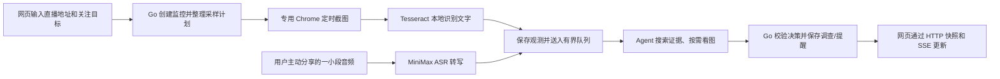

# LiveGuard 项目导览：从目录到一次提醒

这份文档带第一次接触 LiveGuard 的开发者走一遍项目。目标是读完后知道：代码分别放在哪里、一次监控怎样从网页走到提醒、系统把哪些状态交给 Go 管理、模型又在哪些地方受限制，以及当前测试能证明什么。

这里的“Agent”指会根据上下文选择受限工具、再根据工具结果继续判断的模型程序。它不是一个可以任意操作电脑的机器人。Go 服务负责采集调度、权限检查、状态更新和最终提交；模型只负责有限范围内的解释和建议。

## 先看全貌

LiveGuard 持续做三件事：观察直播页面、把观察转换成文字或画面线索、判断这些线索是否值得提醒。它没有能力看到采样间隔中出现又消失的内容，因此“持续监控”表示任务持续运行，不代表视频每一帧都被检查。

OCR 是“光学字符识别”：把截图里的字读出来。ASR 是“自动语音识别”：把用户授权的音频转成文字。SSE 是网页打开的一条服务器推送连接；LiveGuard 用它提示页面刷新，真正的监控详情仍由 HTTP 接口读取。

## 目录地图

| 路径 | 放什么 | 第一次阅读时看哪里 |
|---|---|---|
| `cmd/liveguard/main.go` | 可执行程序入口：读配置、选择存储、组装服务、启动 HTTP、优雅关闭 | `main` 看组件怎样接线；它不实现直播判断规则 |
| `cmd/monitor-eval/main.go` | 调用真实 MiniMax 配置运行固定文字评测并写 JSON 报告 | 查看命令参数和退出条件 |
| `cmd/monitor-load/main.go` | 启动合成信号负载测量并写 JSON 报告 | 注意报告明确标注 mock/no capture |
| `internal/domain` | 通用事件 ID 和 Web 推送事件等基础类型 | 不放直播领域判断 |
| `internal/agent` | 与业务无关的模型工具循环、HTTP 客户端、有限重试和熔断器 | 从 `loop.go` 看模型如何被限制 |
| `internal/browser` | 专用 Chrome 会话、直播 URL 校验、DevTools 截图 | 从 `live_capture.go` 看真实采集入口 |
| `internal/monitor` | 核心业务：监控状态、队列、证据、模型适配、工具、仓储、评测 | 先读本页的“调用路线”，再挑对应文件 |
| `internal/web` | HTTP API、SSE、本地网页静态文件和请求校验 | `server.go` 路由；`static/` 是网页 |
| `internal/telemetry` | 可选 OTLP trace 导出初始化 | 当前观测范围见运行文档 |
| `scripts` | Windows 快速启动、显式模型验证、人工验收导出 | 脚本的 API 调用可能产生费用，使用前看注释 |
| `docs` | 架构、运行、评测、风险与本项目导览 | 从本页开始 |
| `runtime` | 运行时创建的本地状态、浏览器资料和图片证据 | 不应提交到 Git；具体留存见运行文档 |

`internal` 是 Go 的约定目录：它表示这些包是项目内部实现，不承诺作为外部库接口长期兼容。`cmd` 则放“如何启动某个程序”，核心规则仍应在 `internal`，才能被网页服务、测试和命令行评测共用。

## 核心名词：先用日常话理解

| 名词 | 在 LiveGuard 里是什么意思 | 容易混淆的地方 |
|---|---|---|
| **Run（监控会话）** | 用户创建的一张持续监控任务，含目标、计划、状态、历史和提醒 | Run 可以跑很久；一次判断不是一个 Run |
| **Room（直播窗口）** | Run 当前观察的直播页面；现在每个 Run 建一个 Room | 不是独立账号，也不是模型会话 |
| **Signal / Event（观测）** | 某个时间从 OCR、ASR 或画面采样得到的一条输入记录 | 观测是“看到了什么”，还不是“发生了什么” |
| **Evidence（证据）** | 调查引用的观测或已检查图片，附来源、时间和目标版本 | 有 OCR 文字不代表它一定来自聊天区 |
| **Investigation（调查）** | Agent 对一条触发观测做的一次有限判断，保留结论和工具步骤 | 失败的调查不等于整个 Run 失败 |
| **Alert（提醒）** | Go 验证后写入 Run 的提醒记录 | 网页标记已读不等于后端提醒被删除 |
| **Pending（待处理）** | 当前进程内正在排队、判断或已处理的工作统计 | 不是可从数据库恢复的任务检查点 |
| **GoalVersion（目标版本）** | 用户每次修改关注目标时递增的数字 | 用来阻止旧目标下的迟到结果污染新目标 |
| **Repository（仓储）** | 读写 Run 和观测的存储接口 | Memory、JSON 文件和 PostgreSQL 是不同实现 |
| **Harness（执行框架）** | 驱动模型多轮调用工具，并限制次数和时间的通用代码 | 它负责“怎样安全执行”，不负责“直播语义是什么” |

Run 状态、采集健康和单次调查状态是三条独立状态线。例如 Run 仍是 `running`，Room 却可能是 `needs_login`；一条 Investigation 也可能是 `failed`，而监控继续接收后续信号。分开记录可以回答“任务是否还开着”“采集是否正常”“这一条判断是否完成”三个不同问题。

## 一次监控从开始到结束

### 1. 网页创建任务

网页把直播 URL、关注目标和采集模式发给 `POST /api/monitors`。`internal/web/server.go` 先限制请求体大小并做基本格式校验，然后调用 `monitor.Service.Start`。服务会再校验 URL、目标长度和模式，并限制最多同时运行 8 个监控。

采集模式有三种：

- `browser_ocr`：启动真实 Chrome 截图和 OCR；需要 Chrome 与 Tesseract 配好。
- `ocr_upload`：由接口/用户提供图片，再走 OCR。
- `demo_replay`：送入固定合成信号，用于演示。它不是实时采集证明。

默认模式是 `demo_replay`。因此，看到演示页面有提醒，不足以证明 Chrome 登录、截图和 OCR 已经可用。

### 2. 目标变成有限计划

`GoalPlanner` 根据自然语言目标生成 `MonitoringPlan`，例如采样频率、是否需要看图、关注整个页面还是聊天区域。LLM 是大型语言模型的缩写。若规划模型失败，服务回退到 Go 中的本地默认计划；之后会由 Go 再做一次范围归一化。模型提出计划，但不能把间隔改成 Go 允许范围之外的值。

计划只回答“怎样观察比较合适”，不是事件判断本身。模型提供方（MiniMax、OpenAI 兼容接口、DeepSeek）通过共同的 `ToolModel` / `ModelSession` 接口接入，业务判断不应散落在各提供方的 HTTP 适配器里。

### 3. 服务创建 Run 并启动运行时

Run 初始为 `running`，目标版本从 1 开始，Room 的采集健康为 `waiting_signal`。服务把 Run 保存到 Repository，然后在后台创建一个运行 context、一个待处理队列，并按采集模式启动演示回放或浏览器采集循环。

Context 是 Go 传递“还可以继续吗”的对象。用户暂停、停止、修改目标或进程退出时，服务取消旧 context，让正在进行的可取消工作尽早结束。

### 4. 采集与识别分开运行

真实采集时，`internal/browser/live_capture.go` 通过专用 Chrome 和 Chrome DevTools Protocol（CDP，Chrome 的自动化控制通道）截图。`capture_pipeline.go` 的截图循环与 OCR worker 分开：两帧缓冲队列满时，新截图会被丢弃并计数；OCR worker 使用 Tesseract 识别后删除临时图片。

新的 OCR 行会通过 `OCRLineDeduper` 去掉重复文字，再成为 `SignalEvent`。同一屏幕可能因计时器等变化出现不同文字，因此“有新 OCR 行”不等于“出现了目标事件”。没有新文字时，也可能按视觉计划产生一次 frame 检查信号。

音频路径不同：只有用户从监控卡片主动分享音频后，浏览器音频片段才被上传；`MiniMaxTranscriber` 转写出文字后，文字与 OCR 一样进入信号接收路径。ASR 未接入 OCR worker，也不代表系统在后台监听所有设备音频。

### 5. 信号先被接收，再等待判断

`acceptSignal` 会检查来源、文字长度、置信度、观测时间、Room 归属和 Run 状态；没有 ID 时会生成 ID，并分配单调递增的序号。它会同时写入观测历史和短期接收回执。

配置了模型 Reviewer 时，真实网页/API 使用 `SubmitSignal`：它把工作放进每 Run 一个有界队列，快速返回 `202 Accepted`，表示“已接收/排队”，不是“已提醒”。没有配置 Reviewer 时，`SubmitSignal` 会回退到同步 `Ingest`，运行本地规则路径。同步 `Ingest` 也供兼容调用和测试/合成负载使用；它可能直接在调用方线程内做判断，繁忙时的行为与异步队列不同。

队列每个 Run 最多等 8 条，另有一条可以正在处理；相同文字、背景画面和符合规则的数值更新可以合并，取消/更正可获得有限优先级。等待超过 30 秒优先级会上升。排队信号有有效期，过期后不再要求模型判断，但历史观测保留。队列满时会拒绝新的工作并返回原因；调用方可用同一个 ID 重试。

### 6. 调查只获得少量上下文

`AgentReviewer` 为每条任务新建模型会话，输入包含目标、计划、当前触发信号、少量近期观测、当前时间和工具说明。它不会把整场直播或所有旧模型对话塞进 prompt（发给模型的上下文）。Agent 需要更多信息时再调用工具：

- `search_observations`：按目标、来源、文字、时间和分页游标检索流水。
- `search_recent_alerts`：看近期是否提醒过相似内容。
- `inspect_live_frame`：按需检查当前画面或已保存的图片。
- `save_frame_evidence`：把当前检查的图片明确归档。
- `request_user_input`：只有需要用户定义偏好时才询问。
- `create_alert`：提出创建提醒的请求；不是绕开 Go 校验的后门。

工具结果会回到同一次模型会话，模型可继续下一轮。一般调查最多 4 轮、8 次工具调用、总计 35 秒；每个工具最多 12 秒。Terminal tool（终止工具）必须单独调用：例如提醒已创建后，模型不能在同一批再提出其他副作用操作。

### 7. Go 决定是否落库

模型返回 `alert`、`wait` 或 `ignore` 等动作后，Go 检查调查是否完整、置信度、证据引用、图片前置条件、重复提醒、Run 是否仍运行，以及 GoalVersion 是否仍匹配。对于依赖图片或聊天区域的提醒，只有文字证据并不够。

模型请求发生在仓储事务/锁之外，避免网络慢时阻塞状态读写。完成后通过 `Repository.Update` 原子写入 Investigation 和可能的 Alert。若这期间用户改了目标、暂停或停止，旧 context 会取消；即使提供方没能及时停止，最终提交仍会二次校验状态和版本，迟到结果不会生效。

### 8. 网页读取状态

网页通过 GET 接口重新读取 Run 的当前快照，通过 `/api/events` 的 SSE 收到“状态有变化”的提示。SSE 不是持久消息队列，也不保存断线期间的每一条事件；重新连接后应重新 GET 快照。Alert 写入后仍保存在 Run，网页“已读”只是浏览器 `localStorage` 中的展示状态。

## 状态设计：把生命周期和一次判断分开

### Run 生命周期

| 状态 | 含义 | 常见后继 |
|---|---|---|
| `running` | 监控任务接受信号并运行采集/调查 | `paused`、`stopped`、`failed`、`completed` |
| `paused` | 用户暂时停下；身份和历史保留 | `running`（Resume）或 `stopped` |
| `stopped` | 用户明确结束 | 终态 |
| `failed` | 当前监控无法继续的终态失败 | 终态 |
| `completed` | 任务自然完成的终态；当前常驻监控通常不会自行结束 | 终态 |

正常监控没有墙钟时长上限。一次调查的 35 秒超时只结束该条判断，不会自动停止 Run。

Go 只允许这些 Run 状态转换：`running → paused/stopped/failed/completed`，`paused → running/stopped/failed`。不允许把已停止的 Run 直接改回运行；需要继续时，用户恢复的是 `paused` Run。合法转换由 `repository.go` 校验，并由 `state.go` 的 `TransitionRun` 提供统一入口。

### Investigation 状态

`reviewing` 表示正在判断；`waiting` 表示证据不足，后面可由新信号再判断；`waiting_user` 表示系统确实需要用户补充规则；`confirmed` 表示提醒已确认；`suppressed` 表示无需提醒或流程被取消；`failed` 表示本次判断出错或被规则阻止。合法状态迁移集中在 `state.go`，不要在页面或模型适配器里自行拼状态字符串来代替迁移规则。

### 观测回执、任务状态和提醒不是一回事

接收回执用于短期识别重复请求；观测流水用于历史查询；Pending 用来展示当前队列；Investigation 记录判断过程；Alert 才表示已持久化的提醒。这些记录解决不同问题。回执存在，不能推出调查完成；调查完成，也不能推出用户已经看到页面提醒。

## 异步、失败、重试与幂等

### 流式与异步

模型工具循环是“多轮请求”：模型决定调用工具，服务执行工具并返回结果，模型再决定下一步。网页更新采用 SSE，但 LiveGuard 没有把模型 token 逐个流到网页；这里的“流式”主要指持续采集信号以及服务端推送状态变化，不要将它描述成 token streaming。

后台 `SubmitSignal` 与 HTTP 客户端连接解耦：成功入队后，浏览器断开不会取消监控 context 上的任务。暂停/停止会取消整个 Run 的 context 和队列；每条任务还有自己的有效期 deadline。Go 的 context 超时只能要求协作式代码退出，不能强制终止忽略取消信号的任意代码。

### 哪些会重试

| 工作 | 当前失败处理 |
|---|---|
| 模型 HTTP 请求 | 对可重放的网络错误、408/429/500/502/503/504 最多重试一次；默认等待 250ms；`Retry-After` 大于 2 秒时不等待重试 |
| 401/403 等鉴权错误 | 不做无意义的传输重试 |
| 多次模型失败 | 连续失败到阈值后熔断 30 秒；冷却后只允许一个恢复探测 |
| 模型给出错误格式 | 同一次调查最多让模型修正一次；修正占用原有轮数预算 |
| 工具调用 | 有单工具 12 秒限制；失败记录在调查轨迹，不会自动重放有副作用的工具 |
| 截图/OCR | 短时错误退避；连续 3 次失败暂停输入并显示错误，用户处理页面后可暂停再继续 |
| 队列任务 | 有 deadline；过期丢弃调查工作，但不删掉已经保存的观测 |
| 进程重启 | 持久模式将旧 `running` Run 标为 `paused`；不会自动重放旧队列或接续浏览器操作 |

传输重试可能造成模型提供方对两次请求都计费。LiveGuard 不重试 `create_alert` 等业务副作用工具：重复业务操作要靠接收 ID、业务去重和最终状态检查控制，不能把“再发一次 HTTP”当成安全重试。

### 幂等和过期结果

幂等的意思是，同一个可识别请求重复发送，不会重复创建观测或提醒。信号 JSON 可提供 Event ID；OCR/音频上传可通过 `Idempotency-Key` 头传 ID。相同 ID、相同内容会作为重复请求；相同 ID、不同内容返回冲突。接收回执最多保留 2,048 条、最长 24 小时，因此它不是永久防重账本。

提醒还有语义去重窗口；这能拦下近似重复提醒，但不是对任意改写都正确的事件身份系统。旧调查是否可以提交，还要检查 GoalVersion、Run 状态、证据有效期和更新的取消/更正。多个检查层各自负责一类重复或迟到风险。

## 数据存在哪里

| 数据 | `local` 默认模式 | `durable` PostgreSQL 模式 |
|---|---|---|
| Run 快照 | `runtime/liveguard.json` 原子替换写入 | `live_monitor_runs.payload` JSONB |
| 完整观测流水 | `runtime/liveguard.json.observations.jsonl` 追加写入 | `live_monitor_observations` 表 |
| 队列和在途取消 | 仅进程内存 | 仍仅进程内存 |
| Agent 选择保存的图片 | `runtime/frames/` | 仍由 `LIVEGUARD_FRAME_ARCHIVE_DIR` 指向的本机目录管理 |
| Chrome 登录状态 | `runtime/live-profile/` | 仍由本机目录保存 |
| 模型 API Key | 进程内存/环境变量 | 进程内存/环境变量 |

Memory Repository 只在当前进程存储状态。`local` 是默认文件模式，不是纯内存。`durable` 需要用户提供的 PostgreSQL。即使 Run 和观测已经持久化，当前也没有持久任务队列，所以重启后恢复的是“可继续的监控卡片和历史”，不是中断调查的精确续跑。观测和图片没有自动清理策略，磁盘会随时间增长。

## 评测与吞吐/延迟：现有证据能说明什么

项目已有三种不同的验证工具，不能混成一个“端到端已测过”的结论：

1. **Go 自动化测试**覆盖状态迁移、队列边界、超时、取消、工具白名单、去重、网页路由等模拟场景。测试覆盖边界行为，不等于生产流量压测。
2. **文字模型评测**用固定的人工标注案例调用真实 Reviewer，统计提醒 precision/recall、误报率、单条调查 P95、token 和工具调用。仓库记录的 MiniMax 历史 holdout 是 2026-10-04 的 27/30；它不是当前代码的实时成绩，也不是 Chrome/OCR/ASR 端到端评测。
3. **`cmd/monitor-load` 合成负载**每次提交 160 条（可配置），用 8 个 worker、8 个内存 Run 和 40ms mock Reviewer，输出接受数、吞吐、并发峰值、背压以及 P95 `Ingest` 耗时。它调用同步 `Ingest`，不测 `SubmitSignal` 的异步排队等待，也不含浏览器、OCR、ASR、网络、真实模型或 token 成本。

因此，已有“某条同步服务路径的合成接收/判断负载测量”和“模型固定文字调查延迟”证据；还不能证明真实系统吞吐、异步队列 P95、端到端提醒延迟或真实直播漏采率。**若目标是把 Agent 工程能力讲扎实，建议补一组异步队列负载测量，而不是再加一份只 mock 单函数的数字。**至少记录：提交到接收的延迟、排队时长、提交到调查完成时长、提醒延迟、接受/拒绝/合并/过期数量、队列峰值、模型并发峰值；注明硬件、Go 版本、运行时长、每 Run 信号速率和 mock 延迟。之后再用真实录制或可复核直播做采集漏失测量。当前是否要新增压测取决于这次交付是否要求宣称异步吞吐；本仓库已有 harness 可以作为起点，已有测试不必为了“看起来完整”重复补。

数据集分 dev 和 holdout。首次查看 holdout 并据此调整提示后，它就不再是未见测试集；后续应增加新版本独立样本。评测失败要能读出具体案例和原因，不只展示一次成功对话。

## 推荐阅读顺序

1. 看 `README.md`，获取产品范围、运行方式和文档索引。
2. 看本页，再按一次调用路线阅读 `cmd/liveguard/main.go` → `internal/web/server.go` → `internal/monitor/service.go` → `internal/monitor/pending.go` → `internal/monitor/agent_reviewer.go` → `internal/monitor/review_tools.go`。
3. 跟数据走时看 `internal/monitor/domain.go`、`repository.go`、`ledger.go`；跟持久化走时再看 `file_repository.go` 和 `postgres.go`。
4. 看 `internal/agent/loop.go` 理解通用工具循环，再看 `messages_model.go`、`chat_completions_provider.go` 理解模型协议差异。
5. 看 `internal/monitor/*_test.go` 找边界案例；最后看 `docs/EVALUATION.md` 了解如何运行评测和哪些结论不能外推。

## 进一步阅读

- [架构与 Agent 行为](ARCHITECTURE.md)：各个模块的接口、证据策略、调度、上下文和状态提交细节。
- [运行、配置与故障处理](OPERATIONS.md)：启动参数、API、数据留存、安全边界和常见恢复方式。
- [评测与验证](EVALUATION.md)：测试地图、固定集报告、负载 harness 与真实验收方法。
- [仍存在的风险](PROJECT-REVIEW.md)：采集漏失、存储增长、事件统计和后续优先级。
